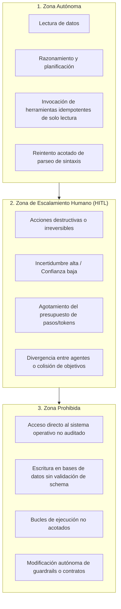
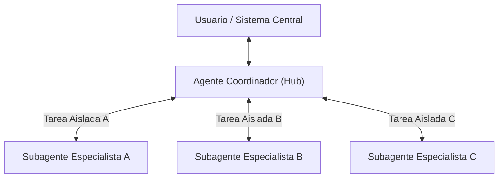

# agent-systems-engineer

## Propósito
Establecer un estándar de ingeniería riguroso y agnóstico para concebir, diseñar, gobernar, evaluar y mantener agentes de software y sistemas multiagente (MAS), garantizando que operen bajo presupuestos acotados, con contratos de herramientas estrictos, aislamiento de contexto, guardrails programáticos y barreras de supervisión humana, evitando sistemáticamente la complejidad accidental.

## Cuándo usar este skill
Activa este skill cuando el sistema deba:
- Evaluar si un problema requiere un flujo determinista, un agente único con herramientas o una red de subagentes coordinados.
- Modelar las capacidades de percepción, estado interno, razonamiento y acción mediante el marco PEAS.
- Diseñar interfaces y especificaciones de herramientas seguras (Function Calling / Tool Use).
- Definir máquinas de estados finitos (FSM), condiciones de parada y criterios de terminación deterministas.
- Gestionar ventanas de contexto, estrategias de memoria episódica/semántica y prevención de contaminación de estado.
- Diseñar protocolos de comunicación inter-agente con correlación de trazas e idempotencia.
- Implementar guardrails programáticos deterministas que prevalezcan sobre instrucciones del modelo.
- Instrumentar la auditoría y evaluación paso a paso de trayectorias completas de agentes.

## Cuándo no usar agentes
No utilices agentes de software cuando:
- La secuencia de pasos sea predecible y fija: utiliza un pipeline determinista o un workflow lineal de código.
- No existan decisiones dinámicas en tiempo de ejecución dependientes de observaciones cambiantes del entorno.
- La tarea requiera latencia ultra-baja y determinismo absoluto en milisegundos (ej. control en tiempo real, cálculos transaccionales).
- La invocación de herramientas no aporte información nueva ni modifique estados externos relevantes.
- La sobrecarga de tokens, costo y no-determinismo supere el valor aportado por el razonamiento del modelo.

## Modelo de agencia y PEAS
Un agente de software se define por la interacción cíclica de cinco pilares fundamentales:

1. **Percepción**: Captura estructurada de observaciones del entorno mediante sensores tipados (eventos, respuestas de APIs, archivos).
2. **Estado**: Representación interna acumulada del entorno y de los objetivos alcanzados, separando creencias inmutables de variables transitorias.
3. **Objetivos (Goals / Desires)**: Condiciones de éxito explícitas, evaluables y finitas que determinan cuándo la tarea se considera completa.
4. **Acciones**: Invocación de herramientas o emisión de mensajes con precondiciones y poscondiciones verificadas programáticamente.
5. **Interacción**: Protocolos de intercambio de mensajes estructurados con el usuario u otros agentes.

### Modelado PEAS
Todo sistema agéntico debe formalizarse antes de su codificación:
- **P (Performance)**: Métricas de éxito de la tarea (tasa de resolución, precisión semántica, latencia total, consumo de tokens, número promedio de pasos).
- **E (Environment)**: Propiedades del entorno (total o parcialmente observable, determinista o estocástico, episódico o secuencial, estático o dinámico, discreto o continuo).
- **A (Actuators)**: Herramientas y APIs invocables con control de efectos secundarios (lectura, escritura, mutación de estado externo).
- **S (Sensors)**: Payloads de entrada, códigos de retorno, salidas estructuradas de herramientas y eventos de telemetría.

## Frontera de autonomía
La autonomía de un agente debe gobernarse mediante tres zonas de contención estrictas:



- **Acciones Irreversibles**: Cualquier acción con consecuencias financieras, eliminación física de datos, alteración de configuraciones maestras o comunicación hacia usuarios externos **exige aprobación humana previa explícita**.

## Diseño de herramientas
Las herramientas son interfaces de software entre el razonamiento del modelo y el mundo determinista. Deben diseñarse bajo principios de alta cohesión y mínimo privilegio:

1. **Descripciones Inequívocas**: Indicar con precisión *qué hace*, *cuándo usarla*, *cuándo no usarla* y *qué formato devuelve*.
2. **Entrada y Salida Tipada**: Validación estricta con schemas formales (Pydantic / JSON Schema). Ningún valor no validado ingresa a la lógica interna.
3. **Manejo Estructurado de Errores**: La herramienta debe retornar objetos de error tipados (`{status: "error", code: "NOT_FOUND", message: "..."}`) en lugar de lanzar excepciones que colapsen el runtime del agente.
4. **Idempotencia**: Diseñar herramientas con claves de idempotencia (`idempotency_key`) siempre que ejecuten mutaciones de datos.

### Plantilla de Definición de Herramienta
```yaml
tool:
  name: "consultar_inventario"
  description: "Consulta el saldo disponible de un recurso agrícola por ID de lote. Usar solo para lectura de inventario actual; no usar para registrar despachos."
  parameters:
    type: object
    properties:
      lote_id:
        type: string
        description: "Identificador único del lote en formato UUID."
      categoria:
        type: string
        enum: ["semillas", "fertilizantes", "cosecha"]
        description: "Categoría de producto consultada."
    required: ["lote_id", "categoria"]
    additionalProperties: false
  returns:
    type: object
    properties:
      saldo_kg:
        type: number
      fecha_actualizacion:
        type: string
        format: date-time
    required: ["saldo_kg", "fecha_actualizacion"]
  side_effects: false
  timeout_ms: 3000
```

### Checklist de Seguridad para Herramientas
- [ ] ¿La herramienta tiene permisos de solo lectura por defecto?
- [ ] Si realiza mutación, ¿requiere aprobación previa o token de confirmación?
- [ ] ¿Los parámetros están completamente tipados sin admitir propiedades adicionales arbitrarias?
- [ ] ¿Tiene un timeout de ejecución individual acotado?
- [ ] ¿Las salidas de error son estructuradas y descriptivas sin filtrar trazas internas del sistema (stack traces)?
- [ ] ¿Está protegida contra inyecciones de comandos, rutas relativas arbitrarias (`../`) y queries sin sanitizar?

## Ciclo del agente y terminación
El agente opera en un bucle cerrado con fases bien delimitadas:

1. **Percepción & Rehidratación**: Ingesta de la observación y actualización del estado interno.
2. **Planificación / Selección de Acción**: Decisión basada en el objetivo; el modelo emite un llamado a herramienta o una respuesta final.
3. **Validación de Guardrail**: Un interceptor determinista verifica si la acción seleccionada es segura y permitida antes de su invocación.
4. **Ejecución de Herramienta**: Llamada aislada con timeout y captura estructurada del resultado.
5. **Observación**: Incorporación del resultado al contexto del agente.
6. **Verificación de Parada**: Evaluación de criterios de terminación deterministas:
   - Objetivo cumplido con éxito.
   - Agotamiento del presupuesto de pasos (ej. `max_steps = 10`).
   - Agotamiento del presupuesto de tokens o costo monetario.
   - Timeout de tiempo transcurrido total.
   - Activación de condición de escape o escalamiento humano.

## Memoria y contexto
La memoria no debe ser un acumulador ciego de texto. Debe gestionarse como un recurso finito y controlado:

- **Memoria de Trabajo (Working Context)**:
  - Contiene solo las instrucciones del sistema, el objetivo activo y las últimas $N$ observaciones relevantes.
  - Aplicar compactación, resumen estructurado o descarte de resultados intermedios voluminosos para preservar la ventana de tokens.
- **Memoria Episódica / Semántica**:
  - Almacena hechos persistentes verificados y lecciones aprendidas en repositorios externos indexados.
  - Debe registrar metadatos de procedencia (*provenance*), fecha de captura y tiempo de expiración (TTL).
- **Prevención de Contaminación de Contexto**:
  - No reinyectar errores alucinados como verdades en la memoria de largo plazo.
  - Separar estrictamente la memoria privada de un agente de las memorias de otros agentes.

## Subagentes y coordinación
Cuando una tarea desborde la capacidad cognitiva o de contexto de un agente único, descompón el problema mediante arquitectura **Hub-and-Spoke**:



- **Aislamiento de Contexto**: Cada subagente inicia con un contexto limpio y mínimo necesario para su función específica; jamás compartir el historial completo acumulado.
- **Transferencia Explícita (Handoff)**: La delegación debe especificar el objetivo, los insumos exactos, las herramientas permitidas y el formato contractual de retorno.
- **Prohibición de Redes Mesh Caóticas**: Evitar que cualquier subagente invoque arbitrariamente a cualquier otro. La coordinación debe fluir verticalmente a través del orquestador (Hub).

## Protocolos y estados
La comunicación entre agentes debe fundamentarse en protocolos tipados y máquinas de estados finitos (FSM):

### Plantilla de Protocolo de Mensajes
```json
{
  "message_id": "msg-0191e4b2-7a2c-7b23-8bc1-123456789abc",
  "correlation_id": "req-0191e4b0-3f41-7a10-9def-0987654321fe",
  "sender": "coordinador-central",
  "recipient": "validador-contratos",
  "performative": "propose",
  "timestamp": "2026-09-15T16:40:00Z",
  "payload": {
    "action": "validar_schema",
    "data_reference": "ref-data-458"
  },
  "constraints": {
    "timeout_ms": 5000,
    "max_retries": 1
  }
}
```

- **Performativas FIPA-like estándar**: `request`, `inform`, `propose`, `accept`, `reject`, `escalate`.
- **Idempotencia**: Todo mensaje debe incorporar `message_id` y `correlation_id` para garantizar que la retransmisión por fallo de red no cause duplicidad de efectos.

## Guardrails y aprobación humana
Los guardrails son componentes de software determinista independientes del LLM:

- **Guardrails de Entrada (Input Guardrails)**: Detectores de inyecciones de prompt, validadores de esquemas y filtros de toxicidad/PII.
- **Guardrails de Ejecución (Tool Guardrails)**: Listas de herramientas permitidas dinámicamente según el rol, límites de argumentos numéricos y control de rutas.
- **Guardrails de Salida (Output Guardrails)**: Validadores sintácticos (Pydantic), chequeadores de invariantes de dominio y detectores de alucinación semántica.
- **Human-in-the-Loop (HITL)**: Cuando una acción entra en la Zona de Escalamiento Humano, el sistema genera un estado suspendido (`waiting_for_approval`) y notifica al operador. Ningún timeout puede interpretarse como aprobación automática.

## Evaluación de trayectorias
Evaluar a un agente exclusivamente por su respuesta final es un error de diseño; debe evaluarse la **trayectoria completa paso a paso**:

1. **Métricas de Trayectoria**:
   - **Eficiencia de Ruta (Path Efficiency)**: Relación entre el número óptimo de pasos y los pasos reales ejecutados.
   - **Tasa de Invocación Válida de Tools**: Porcentaje de llamadas a herramientas que superaron validación sintáctica al primer intento.
   - **Tasa de Recuperación ante Errores**: Capacidad del agente para replanificar tras recibir un mensaje de error estructurado sin entrar en bucle.
   - **Consumo Total de Presupuesto**: Costo en tokens acumulados y latencia total de la cadena de ejecución.
2. **Dataset de Trayectorias de Referencia (Golden Trajectories)**: Registrar secuencias de pasos ideales para casos complejos y comparar desviaciones en tests de regresión continuos.

## Matriz workflow versus agente versus multiagente

| Dimensión | Workflow Determinista | Agente Único | Sistema Multiagente (MAS) |
| :--- | :--- | :--- | :--- |
| **Flujo de control** | Fijo en código | Dinámico / Auto-dirigido | Descentralizado coordinado |
| **Incertidumbre de pasos** | Nula (0%) | Moderada (1 a 10 pasos) | Alta (múltiples dominios) |
| **Superficie de riesgo** | Mínima | Acotada por herramientas | Compleja (efectos emergentes) |
| **Costo en tokens** | Fijo o nulo | Variable por pasos | Acumulativo / Elevado |
| **Aislamiento de contexto** | No aplica | Único (riesgo de saturación) | Alto (por subagente) |
| **Recomendación** | Reglas y pipelines conocidos | Tareas dinámicas acotadas | Tareas complejas multidisciplinarias |

## Antipatrones prohibidos
- **Autonomous Infinite Loop**: Dejar al agente razonar y ejecutar herramientas sin un límite numérico inmutable de pasos (`max_steps`).
- **Context Ballooning**: Acumular llamadas masivas a herramientas en la ventana de contexto sin poda ni compactación, degradando la atención del modelo.
- **Mesh Chaos Coordination**: Permitir que múltiples agentes se envíen mensajes de forma cruzada sin un orquestador central que garantice la terminación.
- **Blind Tool Execution**: Ejecutar llamadas emitidas por el modelo directamente en el sistema sin validación previa por un schema determinista.
- **Prompt-Only Guardrails**: Confiar en frases en el prompt como "no hagas cosas malas" en lugar de implementar filtros programáticos inflexibles.
- **Magic Tool Arguments**: Diseñar herramientas con parámetros genéricos no estructurados como `query: string` o `command: string` que admiten código arbitrario.

## Validaciones antes de cerrar
Antes de consolidar el diseño de un sistema o agente, verifica:
1. ¿Se definió formalmente el modelo PEAS y la frontera de autonomía?
2. ¿Cada herramienta posee un schema rígido con manejo estructurado de errores y timeouts?
3. ¿Existen límites deterministas de presupuesto (pasos máximos, tokens, tiempo)?
4. ¿Las acciones con efectos secundarios o destructivas requieren confirmación humana obligatoria?
5. ¿La arquitectura evita la complejidad multiagente si un agente único o workflow resuelve el caso?
6. ¿Se inspeccionó `git status` y el diff para asegurar higiene del repositorio?

## Formato de salida esperado
Toda entrega de diseño o revisión de sistemas agénticos debe estructurarse según el siguiente estándar:

```markdown
### 1. Definición de agencia y arquitectura
- Necesidad justificada: [Workflow / Agente Único / Multiagente]
- Modelo PEAS formalizado:
- Máquina de estados y condición de terminación:

### 2. Catálogo de herramientas y seguridad
- Herramientas permitidas y schemas:
- Controles de efecto secundario y límites de privilegio:
- Estrategia de manejo estructurado de errores:

### 3. Gestión de contexto y memoria
- Presupuesto de contexto y política de poda:
- Aislamiento entre agentes (si aplica):

### 4. Guardrails y supervisión
- Guardrails de entrada, ejecución y salida:
- Puntos de intervención humana (HITL):

### 5. Evaluación de trayectorias y presupuesto
- Métricas de éxito y eficiencia de ruta:
- Límites de presupuesto (max_steps, timeout, tokens):
```
