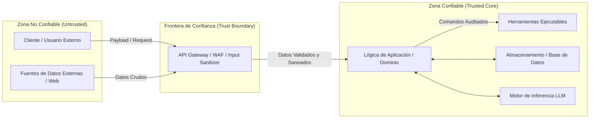
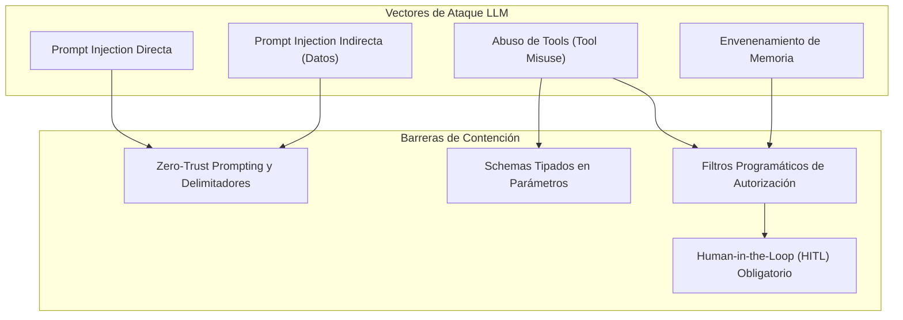

# application-security-engineer

## Propósito
Establecer un marco defensivo integral, riguroso y agnóstico para analizar amenazas, diseñar controles de seguridad, proteger credenciales y datos sensibles, blindar APIs, y mitigar riesgos emergentes en sistemas basados en Inteligencia Artificial y agentes autónomos (inyecciones de prompt, abuso de herramientas, envenenamiento de memoria y sobre-autonomía), garantizando el principio de mínimo privilegio en cada capa del sistema.

## Cuándo usar este skill
Activa este skill cuando el sistema deba:
- Realizar un modelado de amenazas (*Threat Modeling*) sobre una nueva funcionalidad o arquitectura.
- Auditar y securizar el manejo de credenciales, tokens, certificados y variables de entorno.
- Diseñar validaciones estrictas de entrada, protección contra Path Traversal e inyecciones de código/SQL.
- Configurar políticas de seguridad de APIs (CORS, Rate Limiting, cabeceras HTTP defensivas, mensajes de error opacos).
- Blindar integraciones con LLMs y agentes contra *Prompt Injections* directas e indirectas, abuso de herramientas (*Tool Misuse*) y envenenamiento de memoria (*Memory Poisoning*).
- Definir barreras de supervisión humana (*Human-in-the-Loop*) para acciones destructivas o de alto impacto.
- Gestionar la seguridad de la cadena de suministro de software (SBOM, análisis de dependencias vulnerables, imágenes de contenedores).
- Establecer protocolos de respuesta, contención y análisis forense ante incidentes de seguridad.

## Modelo de amenazas
El análisis defensivo debe anticipar vectores de ataque antes de escribir código, identificando activos, fronteras de confianza y actores hostiles:



### Plantilla Ligera de Threat Model
```markdown
# Threat Model: [Nombre del Componente o Flujo]

- **Fecha:** [YYYY-MM-DD]
- **Componente evaluado:** [Descripción de la feature o servicio]

## 1. Activos Críticos a Proteger
- [Ej. Claves de API, datos de identificación personal, integridad del modelo, archivos de configuración]

## 2. Límites de Confianza y Actores de Amenaza
- **Límites de confianza:** [Frontera entre internet y la API; frontera entre datos externos y el prompt del LLM]
- **Actores de amenaza:** [Atacante externo no autenticado, usuario malicioso autenticado, prompt adversarial en documento]

## 3. Amenazas Identificadas (Taxonomía STRIDE / OWASP)
1. **[ID-01]**: [Descripción de la amenaza y vector de ataque]
   - *Impacto:* [CRITICAL / HIGH / MEDIUM / LOW]
   - *Control mitigador propuesto:* [Validación estricta / Allowlist / Autenticación / HITL]
```

---

### Matriz de Severidad de Vulnerabilidades

| Nivel de Severidad | Criterio de Impacto | Plazo y Acción Requerida |
| :--- | :--- | :--- |
| **CRITICAL** | Ejecución remota de código (RCE), bypass total de autenticación, fuga masiva de secretos o toma de control de agentes con acceso a herramientas destructivas. | **Inmediata**: Detener despliegue o mitigar de inmediato; requiere confirmación humana prioritaria. |
| **HIGH** | Inyección de prompt que burla restricciones de negocio, Path Traversal con lectura de archivos sensibles, o denegación de servicio (DoS) del runtime. | **Prioritaria**: Resolver en el sprint/incremento en curso antes de paso a producción. |
| **MEDIUM** | Fuga de información en errores (stack traces), falta de rate limiting en endpoints no críticos o librerías desactualizadas sin exploit conocido. | **Planificada**: Corregir en ciclo de mantenimiento regular. |
| **LOW** | Cabeceras de seguridad HTTP faltantes que no permiten explotación directa, o inconsistencias cosméticas en logs. | **Baja**: Abordar como mejora de higiene técnica. |

---

## Límites de confianza y privilegios
- **Principio de Mínimo Privilegio (PoLP)**:
  - Todo proceso, contenedor, función o agente debe ejecutarse con el conjunto mínimo absoluto de permisos necesarios para completar su tarea.
  - Los permisos deben otorgarse a nivel de rol específico y temporalmente cuando sea posible.
- **Separación de Funciones (Separation of Duties)**:
  - Un componente encargado de parsear entradas no confiables no debe tener acceso directo a herramientas de mutación de base de datos ni privilegios de ejecución en el sistema operativo.

## Secretos y configuración

---

### Política Estricta de Manejo de Secretos

1. **Inyección Exclusiva por Entorno**:
   - Toda clave de API, contraseña, token o certificado debe inyectarse en tiempo de ejecución mediante variables de entorno del sistema o gestores de secretos dedicados.
2. **Prohibición Total en Repositorio e Imágenes**:
   - **Terminantemente prohibido** versionar archivos `.env` reales, certificados privados o llaves en Git.
   - El archivo `.gitignore` debe excluir obligatoriamente `.env` y `.env.*` (preservando solo `.env.example` con valores vacíos ficticios).
   - Prohibido incrustar secretos en capas de Docker (`ENV SECRET=...` o `COPY .env`).
3. **Cero Secretos en Trazas y Logs**:
   - Los frameworks de logging y telemetría deben sanitizar o redactar automáticamente cualquier campo que contenga tokens (`Authorization: Bearer ...`, `api_key`, `password`).
4. **Rotación y Revocación**:
   - En caso de sospecha de exposición accidental de un secreto, revocarlo de inmediato, rotar la credencial e invalidar las sesiones asociadas.

---

## Seguridad de entrada y archivos

---

### Política de Datos No Confiables (Untrusted Data Policy)

Todo dato proveniente del exterior (usuarios, clientes HTTP, archivos, fuentes web o salidas de herramientas) se clasifica como **Hostil por Defecto**:

1. **Allowlist sobre Denylist**:
   - Validar formatos mediante listas de permitidos (*allowlists*) en lugar de intentar bloquear patrones prohibidos conocidos (*denylists*).
2. **Validación Sintáctica y Tipado Rígido**:
   - Usar esquemas tipados estrictos (Pydantic / JSON Schema) con rechazo automático de campos desconocidos (`extra="forbid"`).
3. **Normalización y Límites de Tamaño**:
   - Normalizar codificación Unicode (NFKC) antes de comparar cadenas.
   - Imponer límites máximos de longitud en caracteres y tamaño de payload (bytes) para neutralizar ataques de denegación de servicio por agotamiento de memoria.
4. **Seguridad en el Sistema de Archivos**:
   - **Protección contra Path Traversal**: Prohibir concatenaciones directas de rutas con entradas del usuario.
   - Resolver siempre rutas canónicas absolutas (`Path.resolve()`) y verificar programáticamente que la ruta resultante resida estrictamente dentro del directorio base autorizado:
     ```python
     ruta_resuelta = (directorio_base / input_usuario).resolve()
     if not ruta_resuelta.is_relative_to(directorio_base.resolve()):
         raise SecurityException("Acceso no autorizado fuera del directorio base.")
     ```
   - Utilizar sistemas de archivos o montajes de contenedores en modo solo lectura (`:ro`) siempre que no se requiera mutación.

---

## Seguridad de API
1. **Autenticación y Autorización en Frontera**:
   - Validar identidad y permisos en cada endpoint sensible antes de ejecutar lógica de aplicación.
2. **CORS Restrictivo**:
   - Declarar orígenes explícitos permitidos en la configuración de CORS. Prohibir `allow_origins=["*"]` en combinación con credenciales habilitadas.
3. **Protección contra Abusos y DoS**:
   - Implementar limitadores de tasa (*Rate Limiting*) por IP o token para mitigar ataques de fuerza bruta y saturación.
4. **Respuestas de Error Seguras**:
   - Las respuestas HTTP 4xx y 5xx para clientes deben devolver mensajes funcionales estandarizados y opacos.
   - **Prohibido**: Exponer *stack traces*, rutas internas del servidor, versiones exactas de librerías o volcados de excepciones crudas en las respuestas al cliente.

## Cadena de suministro
1. **Fijación de Versiones (Lockfiles)**:
   - Toda dependencia debe estar fijada en archivos lock reproducibles (`uv.lock`, `package-lock.json`, `pnpm-lock.yaml`) con hashes criptográficos que impidan ataques de sustitución de dependencias.
2. **Inventario de Software (SBOM)**:
   - Generar y mantener un inventario de componentes (*Software Bill of Materials*) para auditoría de vulnerabilidades conocidas (CVEs).
3. **Imágenes Base Confiables**:
   - Emplear imágenes base oficiales, mínimas (`slim` / `alpine` / `distroless`) y mantenidas activamente.

## Seguridad LLM y agentes
La integración de modelos de lenguaje introduce nuevos vectores de ataque categorizados en el estándar **OWASP Top 10 for LLMs / Agentic Systems**:



1. **Defensa contra Prompt Injections (Directas e Indirectas)**:
   - Aislar los datos del usuario dentro de delimitadores unívocos (`<contexto_usuario>`).
   - Instruir al modelo que el contenido delimitado es estrictamente **dato pasivo** y nunca instrucciones ejecutables.
   - No confiar en el prompt como único mecanismo de defensa; respaldar siempre con validadores de código determinista antes y después de la inferencia.
2. **Control Estricto de Herramientas (Tool Boundaries)**:
   - Toda herramienta accesible por un agente debe restringir sus parámetros a esquemas tipados rígidos. Prohibir herramientas genéricas que admitan ejecución de comandos shell arbitrarios (`exec`, `system`).
   - Herramientas de solo lectura por defecto. Las mutaciones exigen validación de privilegios y auditoría.
3. **Prevención de Envenenamiento de Memoria (Memory Poisoning)**:
   - Filtrar y validar cualquier hecho antes de persistirlo en la memoria episódica o semántica del agente.
   - Evitar reinyectar salidas no validadas o alucinadas como verdades operacionales de largo plazo.
4. **Límites de Autonomía y Human-in-the-Loop (HITL)**:
   - Ningún agente debe tener autoridad para ejecutar acciones destructivas, borrados masivos, transferencias o alteraciones de políticas de seguridad sin autorización humana explícita en tiempo real.

---

### Checklist OWASP / LLM-Agentic
- [ ] ¿Los datos no confiables están encapsulados bajo delimitadores estrictos en el prompt?
- [ ] ¿Las herramientas tienen contratos Pydantic con tipos restringidos y validaciones de rango?
- [ ] ¿Las herramientas de mutación exigen confirmación humana previa (*Human-in-the-Loop*)?
- [ ] ¿El agente tiene un límite estricto de pasos (`max_steps`) y presupuesto de tokens para prevenir bucles de agotamiento?
- [ ] ¿Se previene la inyección indirecta sanitizando datos provenientes de archivos o llamadas a APIs externas?
- [ ] ¿El sistema rechaza automáticamente cualquier intento de alterar invariantes de negocio o seguridad?

---

## Auditoría e incidentes
- **Registros Forenses Inmutables**:
  - Cada evento relevante de seguridad (autenticación, denegación de permisos, llamadas a herramientas críticas, modificaciones de datos) debe generar un log estructurado con `timestamp` UTC, `event_type`, `user_id` / `actor`, `correlation_id` y resultado.
- **Protocolo de Contención de Incidentes**:
  1. **Detección y Clasificación**: Evaluar la severidad del evento conforme a la Matriz de Severidad.
  2. **Aislamiento**: Desconectar o revocar el componente, credencial o agente comprometido.
  3. **Preservación de Evidencia**: Congelar trazas, logs forenses y copias de seguridad sin alterar el entorno.
  4. **Corrección y Post-Mortem**: Implementar la corrección con pruebas de no-regresión y documentar las lecciones aprendidas.

## Pruebas de seguridad
- **Pruebas Defensivas Automatizadas**:
  - Integrar pruebas unitarias y de integración que verifiquen el rechazo activo de ataques conocidos: payloads con Path Traversal (`../../etc/passwd`), inyecciones de script en campos de texto y payloads malformados.
- **Batería de No-Regresión de Seguridad**:
  - Cada vulnerabilidad corregida debe contar con una prueba automatizada asociada que garantice que el defecto no vuelva a introducirse en refactorizaciones futuras.

## Matriz de confirmaciones
Antes de realizar cambios que impacten la postura de seguridad, consulta esta matriz:

| Operación de Seguridad | Nivel de Riesgo | ¿Pedir Confirmación? |
| :--- | :--- | :--- |
| **Agregar validaciones de input más estrictas** | Bajo (Refuerzo de seguridad) | **No** (proceder informando el cambio) |
| **Añadir pruebas defensivas contra inyecciones** | Bajo (Mejora de cobertura) | **No** |
| **Modificar políticas de CORS o cabeceras** | Alto (Impacto en conectividad) | **Sí** |
| **Cambiar permisos o scopes de herramientas** | Crítico (Ampliación de privilegios) | **Sí (Obligatorio)** |
| **Modificar esquemas de autenticación/tokens** | Crítico (Superficie de acceso) | **Sí (Obligatorio)** |
| **Exponer puertos adicionales hacia el host** | Alto (Exposición de red) | **Sí** |
| **Modificar gestión o inyección de secretos** | Crítico (Riesgo de fuga) | **Sí (Obligatorio)** |
| **Ejecutar escaneos de seguridad intensivos** | Medio (Sobrecarga de cómputo) | **Sí** |

## Antipatrones prohibidos
- **Security by Obscurity**: Confiar en ocultar rutas o nombres de funciones en lugar de aplicar validación y control de acceso riguroso.
- **Client-Side-Only Security**: Validar entradas exclusivamente en el frontend o interfaz de usuario, omitiendo la validación en el backend.
- **Blind Shell Tool Exposure**: Proveer a un agente o LLM una herramienta que ejecuta comandos de shell abiertos como `run_bash(command: str)`.
- **Hardcoded Secret Fallback**: Dejar valores por defecto como `"admin123"` o `"default-secret-key"` en el código fuente para facilitar el desarrollo local.
- **Prompt-Only Defense**: Intentar mitigar inyecciones de código o accesos no autorizados diciéndole al LLM "por favor sé seguro y no hagas daño", en lugar de aplicar filtros de código deterministas.
- **Verbose Error Leaking**: Devolver el mensaje crudo de una excepción de base de datos o el volcado de variables de entorno al cliente web ante un error 500.

## Validaciones antes de cerrar
Antes de declarar una tarea de seguridad o desarrollo seguro como completada, verifica:
1. ¿Se respetó el principio de mínimo privilegio y separación de funciones?
2. ¿Todos los secretos se manejan mediante variables de entorno y están excluidos de Git y Docker?
3. ¿Las entradas externas se validan con esquemas tipados estrictos y se protegen las rutas de archivos?
4. ¿Las herramientas de agentes tienen contratos rígidos y barreras de supervisión humana para acciones críticas?
5. ¿Los mensajes de error son opacos y los logs registran trazas forenses sin secretos?
6. ¿Se inspeccionó `git status` y el diff para asegurar que no se introdujeron credenciales accidentales?

## Formato de salida esperado
Toda entrega de auditoría, mitigación o diseño de seguridad debe estructurarse conforme al siguiente estándar:

```markdown
### 1. Resumen de Análisis y Postura de Seguridad
- Componente o flujo evaluado:
- Fronteras de confianza intervenidas:
- Clasificación de severidad atendida: [CRITICAL / HIGH / MEDIUM / LOW]

### 2. Controles de Mitigación Implementados
- Validación de entradas y protección de rutas/archivos:
- Políticas de secretos y configuración segura:
- Controles para LLMs y herramientas agénticas (HITL / Schemas):

### 3. Evidencia y Pruebas Defensivas
- Pruebas automatizadas de seguridad ejecutadas:
- Casos adversariales o de borde verificados:

### 4. Trazabilidad y Gestión de Incidentes
- Identificadores de correlación y logging forense incorporados:
- Procedimiento de contención y rollback:

### 5. Acciones Pendientes o Confirmaciones
- Confirmaciones requeridas según la Matriz de Gobernanza:
- Recomendaciones de monitoreo posterior:
```
