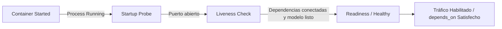

# docker-devops-engineer

## Propósito
Establecer un estándar técnico riguroso y agnóstico para diseñar, construir, contenerizar, operar y depurar aplicaciones locales y distribuidas mediante Docker y Docker Compose, priorizando imágenes inmutables y mínimas, seguridad por diseño (usuario no root, mínimo privilegio), observabilidad de salud (healthchecks/readiness), control estricto de recursos y preservación absoluta de datos persistentes sin prácticas destructivas.

## Cuándo usar este skill
Activa este skill cuando el sistema deba:
- Diseñar o refactorizar archivos `Dockerfile` optimizados con compilación en múltiples etapas (*multi-stage builds*).
- Crear o estructurar archivos `compose.yaml` con redes aisladas, volúmenes con nombre, perfiles y control de dependencias.
- Diseñar sondas de salud (*healthchecks*) y discernir entre inicio del proceso (*startup*) y disponibilidad real del servicio (*readiness*).
- Configurar límites y reservas de recursos de hardware (límites de memoria RAM para evitar OOM, cuotas de CPU).
- Diagnosticar incidentes de infraestructura en contenedores (inspección de logs, análisis de estadísticas de recursos, timeouts de red).
- Estandarizar comandos de ciclo de vida mediante automatización con `Makefile` reproducible.
- Evaluar la seguridad de imágenes (escaneo de vulnerabilidades, reducción de superficie de ataque, exclusión de secretos).

## Imágenes y Dockerfile
La construcción de imágenes de contenedores debe seguir principios de inmutabilidad, minimalismo y reproducibilidad:

1. **Etiquetado Explícito (Pinning)**:
   - Prohibido utilizar el tag mutante `:latest`.
   - Fijar versiones semánticas explícitas o digests criptográficos de imágenes base (ej. `python:3.12-slim-bookworm`, `node:20-alpine3.19`).
2. **Compilación Multi-Stage**:
   - Separar la etapa de compilación/instalación de dependencias (con compiladores, SDKs y cabeceras) de la etapa de ejecución final (*runtime*).
   - Copiar a la etapa final únicamente los binarios o artefactos construidos y las dependencias de producción, reduciendo drásticamente el peso de la imagen y la superficie de ataque.
3. **Optimización del Caché de Capas**:
   - Ordenar las instrucciones desde las que cambian con menor frecuencia hacia las que cambian frecuentemente.
   - Copiar primero los manifests de dependencias (`package.json`, `pyproject.toml`, `uv.lock`) e instalarlas antes de copiar el código fuente de la aplicación.
4. **Higiene con `.dockerignore`**:
   - Excluir obligatoriamente del contexto de build: `.git/`, `.env*`, `node_modules/`, `.venv/`, caches (`__pycache__`), logs, documentación y archivos temporales del sistema operativo.
5. **Usuario No Root**:
   - Crear y asignar un usuario y grupo sin privilegios (`appuser:appgroup`) antes de definir el comando de arranque (`USER appuser`). Nunca ejecutar procesos de aplicación como `root`.

### Checklist Dockerfile
- [ ] ¿La imagen base utiliza un tag de versión específico y una distribución mínima (`slim` / `alpine`)?
- [ ] ¿Se utiliza compilación multi-stage para no incluir herramientas de compilación en runtime?
- [ ] ¿Existe un archivo `.dockerignore` exhaustivo en la raíz del contexto de build?
- [ ] ¿Las dependencias se copian e instalan antes del código fuente para aprovechar el caché de capas?
- [ ] ¿El contenedor ejecuta bajo un usuario no privilegiado (`USER`)?
- [ ] ¿No se incrustaron secretos, credenciales ni archivos `.env` dentro de la imagen?
- [ ] ¿Los comandos de ejecución utilizan la forma `exec` (`CMD ["app", "run"]`) en lugar de shell para propagar señales POSIX (`SIGTERM`)?

## Docker Compose y servicios
Docker Compose debe ser el orquestador declarativo para entornos locales reproducibles:

1. **Topología de Redes Aisladas**:
   - Definir redes internas personalizadas (`driver: bridge`).
   - Aislar servicios de backend y bases de datos en redes internas sin acceso directo desde el host cuando no sea necesario publicar puertos.
2. **Volúmenes con Nombre vs Bind Mounts**:
   - Utilizar volúmenes con nombre gestionados por Docker (`named volumes`) para persistencia de bases de datos o almacenamiento de modelos.
   - Restringir los montajes locales (*bind mounts*) a modo solo lectura (`:ro`) cuando se inyecte configuración o código en desarrollo local.
3. **Perfiles de Servicio (`profiles`)**:
   - Utilizar perfiles (ej. `profiles: ["eval"]`, `profiles: ["tools"]`) para servicios auxiliares que no deben arrancar por defecto en el comando `docker compose up`.
4. **Dependencias Basadas en Salud**:
   - No usar `depends_on` simple (que solo espera que el proceso inicie). Usar siempre la condición basada en salud:
     ```yaml
     depends_on:
       servicio-dependencia:
         condition: service_healthy
     ```

### Checklist Compose
- [ ] ¿Todos los servicios tienen límites explícitos de recursos (`deploy.resources.limits`)?
- [ ] ¿Las dependencias entre servicios utilizan `condition: service_healthy`?
- [ ] ¿Los puertos publicados están limitados estrictamente a los necesarios para el usuario host?
- [ ] ¿Los volúmenes persistentes utilizan volúmenes con nombre o bind mounts `:ro` cuando corresponde?
- [ ] ¿Las variables de entorno dinámicas se inyectan mediante archivo `.env` externo sin quemar valores sensibles en el compose?

## Healthchecks y readiness
Una de las fallas más comunes en orquestación es confundir un contenedor corriendo (*running*) con un servicio listo para operar (*ready*):



1. **Diseño del Healthcheck**:
   - Definir parámetros conservadores para evitar falsos positivos durante la inicialización:
     ```yaml
     healthcheck:
       test: ["CMD-SHELL", "curl -f http://localhost:8000/health/ready || exit 1"]
       interval: 10s
       timeout: 5s
       retries: 3
       start_period: 30s
     ```
2. **Distinción Técnica**:
   - **Startup / Liveness**: ¿El proceso Uvicorn/Node está vivo y respondiendo HTTP 200 en su endpoint básico?
   - **Readiness**: ¿El servicio tiene sus dependencias conectadas, los modelos en memoria y la capacidad para procesar solicitudes reales sin arrojar error 500?

## Recursos y rendimiento
Prevenir caídas por agotamiento de memoria (*Out Of Memory - OOM*) o estrangulamiento de CPU:

1. **Límites de Memoria (`mem_limit`)**:
   - Asignar siempre un tope máximo de memoria a cada contenedor (`deploy.resources.limits.memory`).
   - Si un contenedor de modelo o API requiere 4 GB, limitar a 6 GB para tolerar picos sin que el kernel de Linux active el *OOM Killer* de forma abrupta.
2. **Reservas de Memoria (`mem_reservation`)**:
   - Garantizar la memoria mínima necesaria para que el servicio arranque de forma estable.
3. **Cuotas de CPU**:
   - Limitar la cantidad de núcleos virtuales accesibles (`cpus: "2.0"`) para evitar que un proceso descontrolado congele el equipo anfitrión.

## Datos y persistencia
La preservación de los datos es un invariante crítico:

1. **Prohibición de Eliminación de Volúmenes**:
   - Jamás ejecutar `docker compose down -v` ni `docker volume rm` sin una confirmación explícita y un respaldo previo verificado.
   - La bandera `-v` destruye permanentemente las bases de datos locales, modelos descargados y cachés persistentes.
2. **Estrategia de Respaldo**:
   - Antes de cualquier actualización mayor de esquemas o recreación de contenedores, realizar un dump o copia de seguridad del volumen hacia un directorio externo seguro.

## Seguridad de contenedores
1. **Minimización de Superficie**: No instalar utilidades de depuración en la imagen final (`curl`, `netcat`, `vim`, `gcc`) a menos que sean estrictamente requeridas por el healthcheck.
2. **Sistemas de Archivos de Solo Lectura**:
   - Configurar `read_only: true` en la definición del servicio cuando la aplicación sea sin estado (*stateless*), utilizando `tmpfs` para directorios efímeros necesarios (`/tmp`, `/run`).
3. **Escaneo de Vulnerabilidades**:
   - Auditar imágenes periódicamente con herramientas de análisis estático (ej. Trivy) y generar un SBOM (*Software Bill of Materials*).

## Operación y diagnóstico
Protocolo seguro para diagnosticar problemas sin reiniciar a ciegas:

1. **Inspección de Logs en Vivo**:
   - `docker compose logs -f --tail=100 <servicio>`: inspeccionar trazas recientes sin saturar la terminal.
2. **Métricas en Tiempo Real**:
   - `docker stats --no-stream`: verificar el uso actual de CPU, memoria y ancho de banda de red.
3. **Estado Detallado y Razones de Fallo**:
   - `docker inspect <container_id> --format='{{json .State}}'`: consultar el código de salida exacto, si fue abatido por OOM (`OOMKilled: true`) o el fallo del último healthcheck.

## Makefile y reproducibilidad
Centralizar las operaciones del ciclo de vida en un `Makefile` documentado y consistente:

```makefile
.PHONY: help build start stop health logs clean-containers

help: ## Muestra comandos disponibles
	@grep -E '^[a-zA-Z_-]+:.*?## .*$$' $(MAKEFILE_LIST) | awk 'BEGIN {FS = ":.*?## "}; {printf "\033[36m%-18s\033[0m %s\n", $$1, $$2}'

build: ## Construye las imágenes sin usar cachés corruptas
	docker compose build

start: ## Levanta los servicios en segundo plano
	docker compose up -d

stop: ## Detiene los contenedores sin borrar volúmenes ni datos
	docker compose stop

health: ## Verifica el estado de salud de los servicios
	docker compose ps --format "table {{.Service}}\t{{.State}}\t{{.Health}}"

logs: ## Muestra los logs en tiempo real
	docker compose logs -f --tail=100
```

---

## Matriz de comandos y confirmaciones

| Comando / Operación | Clasificación | Motivo y Riesgo | ¿Pedir Confirmación? |
| :--- | :--- | :--- | :--- |
| `docker compose ps` / `logs` | **Seguro** | Operación de solo lectura / inspección | **No** |
| `docker stats` / `inspect` | **Seguro** | Telemetría y diagnóstico sin efectos | **No** |
| `docker compose up -d` / `stop` | **Seguro** | Ciclo de vida estándar de contenedores | **No** |
| `docker compose restart <srv>` | **Seguro** | Reinicio no destructivo del proceso | **No** |
| **Descarga de modelos/imágenes (> 1GB)** | **Precaución** | Alto consumo de ancho de banda y disco | **Sí** |
| **Modificar `compose.yaml` o `Dockerfile`**| **Sensible** | Alteración estructural de infraestructura | **Sí** |
| **Publicar nuevos puertos en host** | **Sensible** | Exposición de red / superficie de ataque | **Sí** |
| **Cambiar límites de RAM / CPU** | **Sensible** | Riesgo de degradación u OOM | **Sí** |
| `docker compose down -v` | **PROHIBIDO** | Destrucción irrevocable de volúmenes | **SÍ (Crítico)** |
| `docker system prune -a` / `volume rm`| **PROHIBIDO** | Purgado masivo de imágenes y datos | **SÍ (Crítico)** |
| `rm -rf /var/lib/docker` | **PROHIBIDO** | Destrucción catastrófica del host | **TERMINANTE (Nunca)** |

---

## Antipatrones prohibidos
- **Destructive Volume Down (`down -v`)**: Usar la bandera `-v` de forma rutinaria para reiniciar entornos, destruyendo datos y forzando descargas innecesarias.
- **Root-by-Default Execution**: Omitir la directiva `USER` en el Dockerfile, permitiendo que el software corra con privilegios de superusuario dentro del contenedor.
- **Baking Secrets into Layers**: Pasar credenciales o claves privadas en variables `ENV` o mediante `COPY .env`, dejándolas visibles permanentemente en el historial de la imagen.
- **Blind Latest Tagging**: Usar etiquetas mutables como `FROM ubuntu:latest` o `FROM python:3`, causando fallas de construcción impredecibles en el futuro.
- **No-Limits Container Sprawl**: Desplegar contenedores sin directivas de límites de memoria (`mem_limit`), arriesgando la congelación completa de la máquina anfitriona ante fugas de memoria.
- **Fake Healthchecks**: Definir un healthcheck con `CMD-SHELL exit 0` o un ping trivial que responde exitoso aunque la base de datos o el modelo hayan colapsado.

## Validaciones antes de cerrar
Antes de declarar una tarea de infraestructura o Docker como completada, verifica:
1. ¿El Dockerfile utiliza una imagen base con tag explícito y corre bajo usuario no root?
2. ¿El archivo `.dockerignore` previene la inclusión de secretos, `.git` y dependencias locales?
3. ¿Compose define límites de memoria y salud basada en dependencias (`service_healthy`)?
4. ¿Los volúmenes persistentes están protegidos y libres de riesgo de borrado accidental?
5. ¿Las operaciones sensibles (publicación de puertos, descargas pesadas) fueron confirmadas con el usuario?
6. ¿Se probó la construcción y arranque desde una copia limpia sin errores de red o dependencias?
7. ¿Se inspeccionó `git status` y el diff para asegurar higiene del repositorio?

## Formato de salida esperado
Toda propuesta, modificación o reporte de infraestructura de contenedores debe presentarse con la siguiente estructura:

```markdown
### 1. Resumen de Contenerización / Infraestructura
- Servicios intervenidos o creados:
- Estrategia de imágenes (Base, Multi-stage, Usuario no root):
- Redes y volúmenes definidos:

### 2. Recursos, Límites y Salud
- Límites de CPU y Memoria configurados:
- Diseño de sondas de salud (Liveness y Readiness):
- Dependencias entre servicios (`condition: service_healthy`):

### 3. Seguridad y Persistencia
- Exclusiones en `.dockerignore` y manejo de secretos:
- Política de preservación de volúmenes de datos:

### 4. Verificación y Operación Local
- Comandos de ciclo de vida en Makefile (`build`, `start`, `health`):
- Validación de logs y estado de salud (`docker compose ps`):

### 5. Acciones Pendientes o Confirmaciones
- Confirmaciones requeridas (puertos, recursos, descargas):
- Próximos pasos recomendados:
```
