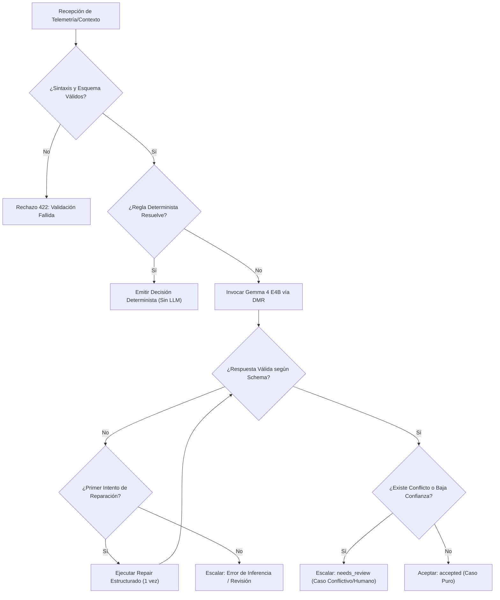

# domain-peas-ebdi

## Propósito
Establecer el marco conceptual, formal y operativo para el desarrollo e inferencia del clasificador de intenciones basado en micro-LLM (Gemma 4 E4B), definiendo con rigor la arquitectura eBDI (emocional Belief-Desire-Intention), el esquema PEAS, las fronteras de autonomía, los invariantes no negociables y la planificación incremental por semanas.

## Cuándo usar este skill
Este skill debe activarse cuando el agente asistente o el desarrollador deba:
- Diseñar o modificar contratos de entrada/salida para el clasificador.
- Tomar decisiones arquitectónicas sobre qué lógica resolver deterministamente y qué delegar al LLM.
- Evaluar los límites de autonomía y criterios de escalamiento ante incertidumbre o conflicto.
- Verificar invariantes del sistema antes de proponer cambios de código o configuración.
- Guiar la implementación según los objetivos específicos de la semana de trabajo actual.
- Validar que no se incurra en sobreingeniería ni en dependencias externas superfluas.

## Contexto del proyecto
El proyecto de grado investiga la integración híbrida entre agentes inteligentes con arquitectura **eBDI** (desarrollados sobre el simulador multi-agente WellProdSim/EthosTerra en Python BESA) y capacidades de razonamiento semántico mediante un **micro-LLM local cuantizado (Gemma 4 E4B)**.
El sistema opera bajo una arquitectura hexagonal, con ejecución estrictamente *offline-first* en hardware Apple Silicon (MacBook Air M4, 16 GB), garantizando soberanía de datos, bajo consumo de memoria y trazabilidad integral de cada inferencia.

## Relación con wellprod-domain
- **`wellprod-domain`** se concentra en la semántica agronómica de bajo nivel de Ethos Terra: taxonomía de intenciones del campesino, detonantes ambientales (sequía, precios), reglas de conservación de recursos específicos (capital, inventario, salud) y la distinción factual entre Caso Puro y Conflictivo.
- **`domain-peas-ebdi`** (esta skill) aporta la estructura metodológica, sistémica y de gobernanza: el modelado PEAS de la fase, la separación estricta de responsabilidades (LLM vs reglas vs humano), los límites éticos/técnicos de autonomía, los invariantes no negociables y la hoja de ruta temporal de desarrollo.
- **Coexistencia**: Ambos skills son complementarios y no se solapan. `wellprod-domain` responde al *¿qué significan los datos agronómicos?*, mientras que `domain-peas-ebdi` responde al *¿cómo opera y hasta dónde llega el agente inteligente dentro del sistema?*.

## Principios arquitectónicos
1. **Separación estricta de responsabilidades**:
   - **El LLM propone**: Gemma 4 E4B genera sugerencias semánticas, clasificaciones preliminares y razonamiento explicativo. Nunca toma decisiones finales de ejecución.
   - **Los validadores verifican**: Esquemas Pydantic y JSON Schema validan rígidamente tipos, rangos, campos requeridos y coherencia sintáctica/semántica.
   - **Las reglas eBDI gobiernan**: La lógica determinista del modelo de agentes evalúa coherencia con creencias previas y deseos activos.
   - **El simulador conserva autoridad**: El simulador multi-agente es la única entidad autorizada para mutar el estado del entorno; permanece desacoplado e inviolable.
   - **El humano supervisa**: El operador humano resuelve dilemas conflictivos, autoriza acciones críticas y calibra la frontera ante incertidumbre.
2. **Soberanía y ejecución local**: Cero llamadas a APIs externas; inferencia gestionada localmente vía Docker Model Runner (DMR) u Ollama.
3. **Monolito modular hexagonal**: Despliegue simple y unificado (API FastAPI, UI React, Runner local) sin microservicios dispersos.
4. **Trazabilidad total**: Cada inferencia registra un `trace_id` único, latencia en milisegundos, digest del prompt y metadatos del modelo.

## PEAS de la fase actual
Para el clasificador de intenciones en la fase actual de evaluación:

- **P (Performance / Rendimiento)**:
  - Latencia por inferencia dentro de umbrales tolerables (< 2000 ms en M4).
  - Tasa de disponibilidad de inferencia (`inference_availability = 1.0`).
  - Recall en Casos Conflictivos (`conflict_recall = 1.0`).
  - Tasa de alucinación nula (0 invenciones de variables inexistentes).
  - Adherencia al 100% al esquema tipado (`caso-puro.schema.json`).
  - Validez metodológica: métricas válidas únicamente si `evaluation_mode="real_model"`.
- **E (Environment / Entorno)**:
  - Entorno local contenedorizado (Docker Desktop con Docker Model Runner activado).
  - Entorno Python gestionado con `uv`.
  - Red aislada local (`http://localhost:8000`, `http://localhost:11434` o socket DMR).
  - Sin acceso a internet durante la inferencia y evaluación.
- **A (Actuators / Actuadores)**:
  - *Actuadores permitidos*: Respuestas HTTP estructuradas (JSON Pydantic), logs de auditoría estructurados, generación de reportes de evaluación (`evals/report.json`).
  - *Actuadores prohibidos*: Escritura en el código o estado interno del simulador BESA, mutación de archivos de reglas de producción, alteración de configuraciones del sistema operativo.
- **S (Sensors / Sensores)**:
  - Payloads JSON recibidos en los endpoints de la API (ej. `POST /classifications:propose`) con telemetría de contexto (id, variables de estado, indicadores de entorno, alarmas y creencias previas).

## Frontera de autonomía
El sistema opera bajo tres zonas de autonomía rígidamente demarcadas:

1. **Zona Autónoma**:
   - Clasificación directa de Casos Puros cuando los sensores y reglas deterministas no presentan contradicciones físicas ni lógicas.
   - Rechazo automático de payloads con sintaxis inválida o violación de esquema.
   - Registro automático de telemetría y métricas de observabilidad.
   - Reintento único de reparación sintáctica ante respuestas malformadas del modelo.
2. **Zona de Escalamiento Humano**:
   - Detección de Casos Conflictivos (dos o más intenciones en colisión excluyente).
   - Incertidumbre en la inferencia (confianza del LLM por debajo del umbral de seguridad, ej. < 0.85).
   - Incompatibilidad entre el razonamiento del LLM y las creencias registradas en el estado del agente.
   - Respuestas ambiguas o fallas tras el único reintento de reparación.
3. **Zona Prohibida**:
   - Mutación o escritura directa sobre el simulador WellProdSim/BESA.
   - Escritura de archivos YAML de configuración de producción sin revisión humana.
   - Invención de recursos, capital o métricas no provistas en la entrada (alucinación activa).
   - Modificación unilateral del baseline experimental o de los esquemas contractuales.
   - Ejecución de comandos del sistema destructivos o no auditados.

## Invariantes no negociables
1. **Invariante del Simulador**: El modelo y el clasificador no modifican, importan ni mutan el núcleo del simulador WellProdSim/BESA. La integración se realizará únicamente en las semanas 10–12 vía interfaces remotas/sockets.
2. **Invariante de Configuración**: Prohibido escribir o sobrescribir archivos de configuración de producción reales sin autorización explícita.
3. **Invariante de Conservación de Datos**: Ningún componente puede inventar atributos, estados ni recursos (capital, inventario, salud) no existentes en el payload recibido.
4. **Invariante de Baseline**: El código y las mediciones de referencia de la Semana 5 son inmutables como punto de partida comparativo.
5. **Invariante de Modelo**: No sustituir Gemma 4 E4B por modelos en la nube ni cambiar su perfil de cuantización sin validación previa.
6. **Invariante de Evaluación Honesta**: Los reportes y métricas son válidos únicamente con inferencia real (`real_model`). Caídas de infraestructura (OOM, timeout) deben registrarse como fallos de sistema y no como exactitud del 0% del modelo.
7. **Invariante de Tipado**: Ninguna salida llega al consumidor sin haber sido validada rigurosamente por el validador Pydantic/JSON Schema.

## Alcance por semana
- **Semana 5 (Baseline - Concluida)**: Monolito modular funcional, API FastAPI, UI React, Docker Model Runner operativo, prueba canaria (`make canary`), harness de evaluación (`evals/runner.py`) y baseline experimental fijado.
- **Semana 6 (Caso Puro y Robustez)**: Formalización de contratos Pydantic para Caso Puro, optimización de prompt engineering estructurado, pruebas de robustez canaria y benchmarking sistemático.
- **Semanas 7–8 (Caso Conflictivo y Ambigüedad)**: Esquemas para Casos Conflictivos, detección de contradicciones físicas/lógicas, lógica de escalamiento a revisión humana y manejo de respuestas adversariales.
- **Semanas 8–9 (CRUD de Intenciones Declarativas)**: Gestión declarativa de intenciones en directorio externo desacoplado, sin tocar el núcleo del sistema.
- **Semanas 10–12 (Integración WellProdSim / BESA)**: Conexión mediante API REST o sockets con el simulador multi-agente real, validación end-to-end de ciclos de simulación y evaluación final.

## Guía de decisión
Ante cualquier tarea o requerimiento de clasificación:


## Antipatrones prohibidos
- **Llamadas innecesarias al LLM**: Invocar al modelo para resolver condiciones que se evalúan inequívocamente con una regla booleana o de rango numérico.
- **Sobreingeniería de frameworks**: Introducir LangGraph, LangChain, bases vectoriales, Redis o Kubernetes cuando una función Pydantic y una llamada HTTP directa cubren el requerimiento con menor latencia y mayor determinismo.
- **Silenciar errores de infraestructura**: Contabilizar un error 500 o timeout de Docker como clasificación incorrecta del modelo, distorsionando las curvas de precisión del experimento.
- **Auto-reparación infinita**: Reintentar llamadas al modelo en bucle tras fallas de validación. La política permite **máximo un reintento** de reparación estructurada.
- **Mutación lateral**: Intentar escribir archivos en directorios protegidos o modificar código durante la ejecución de inferencias.

## Procedimiento operativo
1. **Verificación previa**: Comprobar el estado del runner local (`make health`) antes de iniciar evaluaciones o pruebas.
2. **Planificación**: Explicar el propósito del cambio antes de tocar código estructural.
3. **Aislamiento**: Trabajar dentro de las capas correspondientes (Dominio, Puertos, Adaptadores, API o UI).
4. **Validación canaria**: Probar siempre un caso unitario canario (`make canary`) antes de disparar suites de evaluación masivas.
5. **Observabilidad**: Asegurar que toda respuesta conserve `trace_id`, `model`, `latency_ms` y `prompt_digest`.

## Validaciones antes de cerrar
Antes de dar por concluida cualquier tarea relacionada con el dominio o inferencia:
1. Confirmar que no se violó ningún **Invariante no negociable**.
2. Verificar que los esquemas JSON de `contracts/schemas/` son válidos y compatibles.
3. Asegurar que las pruebas canarias pasan sin errores de tipado.
4. Confirmar que el simulador real WellProdSim/BESA no fue referenciado internamente ni modificado.
5. Garantizar que `git status` refleje un estado limpio y predecible.

## Formato de salida esperado
Toda respuesta del clasificador debe respetar contractualmente la estructura:
```json
{
  "contexto_id": "string",
  "resultado": {
    "tipo": "puro | conflictivo | ambiguo",
    "clasificacion": "string",
    "confianza": 0.0,
    "razonamiento": "string"
  },
  "metadatos": {
    "trace_id": "uuid-string",
    "model": "gemma4:E4B",
    "latency_ms": 0.0,
    "prompt_digest": "sha256-hash"
  }
}
```
En caso de conflicto o incertidumbre que requiera intervención, el campo `resultado.tipo` se emitirá como `"conflictivo"` o `"ambiguo"` con la debida justificación para el operador humano.
