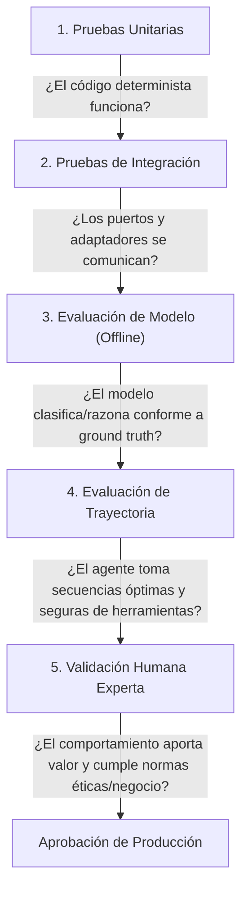

# llm-evaluation-engineer

## Propósito
Establecer un estándar científico, metodológico e ingenieril para concebir, diseñar, versionar, instrumentar y analizar evaluaciones de modelos de lenguaje (LLMs) y sistemas agénticos, asegurando mediciones reproducibles, comparaciones estadísticas justas, trazabilidad integral de inferencias y prevención activa de conclusiones distorsionadas por sesgos o fallos de infraestructura.

## Cuándo usar este skill
Activa este skill cuando el sistema deba:
- Diseñar o auditar un conjunto de datos de prueba curado (Golden Dataset).
- Establecer o congelar una línea base experimental (Baseline) inmutable.
- Definir y calcular métricas cuantitativas de clasificación, generación estructurada, seguridad o rendimiento operativo.
- Instrumentar telemetría y trazas forenses de inferencia (`trace_id`, hashes, latencias, procedencia).
- Diseñar protocolos de evaluación comparativa (pruebas canarias, A/B testing, suites de no-regresión).
- Auditar la validez metodológica de un informe de métricas antes de su publicación o adopción en producción.
- Analizar y categorizar causas raíz de fallas mediante taxonomías rigurosas de error.

## Tipos de prueba y evidencia
En sistemas que integran IA, es imperativo no mezclar niveles de verificación. Cada nivel responde a una pregunta distinta:



1. **Pruebas Unitarias**: Verifican contratos de funciones, schemas Pydantic, lógica booleana y parsing sin invocar al LLM real (usando mocks o stubs deterministas).
2. **Pruebas de Integración**: Verifican conectividad con el runtime de inferencia, endpoints HTTP, bases de datos y serialización de red.
3. **Evaluación de Modelo**: Mide el rendimiento semántico y estadístico del modelo frente a un dataset curado bajo parámetros controlados.
4. **Evaluación de Trayectoria**: Evalúa la secuencia de pasos de un agente autónomo (eficiencia de ruta, selección de herramientas, recuperación ante errores).
5. **Validación Humana por Expertos**: Evaluación cualitativa y de calibración por revisores de dominio sobre muestras estadísticas representativas.

## Diseño de datasets
Un dataset de evaluación no es una colección informal de ejemplos, sino un artefacto de ingeniería versionado:

- **Estructura Requerida por Caso**:
  - `id`: Identificador único inmutable.
  - `input`: Contexto y datos de entrada exactamente como los recibirá el sistema.
  - `expected_output`: Verdad fundamental (*Ground Truth*) verificada por humanos o reglas formales.
  - `invariants`: Condiciones de contorno que jamás deben violarse (ej. "no inventar atributos", "tipo de dato específico").
  - `metadata`: Procedencia (*provenance*), categoría del caso, dificultad y justificación técnica de su inclusión.
- **Taxonomía de Casos en el Dataset**:
  - **Casos Nominales**: Escenarios directos representativos de la operación estándar.
  - **Casos Conflictivos / Dilemas**: Escenarios con requerimientos u observaciones en colisión que exigen arbitraje o abstención.
  - **Casos Ambiguos / Insuficientes**: Payloads con datos incompletos donde la respuesta correcta es la abstención segura (`unclear` / `needs_review`).
  - **Casos Adversariales / Inyecciones**: Payloads con intentos de manipulación de instrucciones o desborde de contratos.

### Esquema Conceptual de un Caso de Evaluación
```json
{
  "$schema": "https://json-schema.org/draft/2020-12/schema",
  "title": "EvaluationCase",
  "type": "object",
  "required": ["id", "version", "category", "input", "expected", "invariants"],
  "properties": {
    "id": { "type": "string", "pattern": "^CASE-[0-9]{4}$" },
    "version": { "type": "string" },
    "category": { "type": "string", "enum": ["nominal", "conflict", "ambiguous", "adversarial"] },
    "input": { "type": "object" },
    "expected": {
      "type": "object",
      "required": ["classification", "can_abstain"],
      "properties": {
        "classification": { "type": "string" },
        "can_abstain": { "type": "boolean" },
        "acceptable_reasoning_keywords": { "type": "array", "items": { "type": "string" } }
      }
    },
    "invariants": {
      "type": "array",
      "items": { "type": "string" },
      "description": "Restricciones estrictas que invalidan la respuesta si se violan."
    },
    "provenance": { "type": "string", "description": "Origen del dato o referencia a especificación." }
  },
  "additionalProperties": false
}
```

## Baselines y versionado
- **Inmutabilidad del Baseline**: Antes de modificar cualquier prompt, modelo, versión de framework, temperatura o conjunto de herramientas, se debe congelar y archivar un informe de referencia (*Baseline Report*) obtenido sobre el dataset oficial.
- **Versionado Cruzado**: Todo reporte experimental debe vincular de forma unívoca:
  - Hash del commit de código (`git_commit_sha`).
  - Versión exacta del prompt y su hash SHA-256 (`prompt_digest`).
  - Versión del dataset (`dataset_version`).
  - Versión exacta del modelo, cuantización y runtime (`model_id`, `runtime_version`).
  - Parámetros de inferencia (`temperature`, `top_p`, `max_tokens`, `seed`).

## Métricas de calidad
El análisis no debe limitarse a una métrica agregada como la exactitud global (*accuracy*), la cual suele ocultar sesgos graves en clases desbalanceadas:

1. **Desacoplamiento de Dimensiones**:
   - **Disponibilidad de Inferencia ($A_{inf}$)**: Proporción de llamadas en las que la infraestructura respondió satisfactoriamente sin timeout ni error 500.
   - **Validez Estructural ($V_{str}$)**: Proporción de respuestas que cumplieron estrictamente con el JSON Schema al primer intento.
   - **Calidad Semántica ($Q_{sem}$)**: Métricas de clasificación y razonamiento calculadas **exclusivamente sobre las respuestas estructuralmente válidas**.
2. **Métricas de Clasificación**:
   - **Matriz de Confusión**: Distribución explícita de Verdaderos Positivos (TP), Falsos Positivos (FP), Verdaderos Negativos (TN) y Falsos Negativos (FN).
   - **Precision**: $\frac{TP}{TP + FP}$ (relevante cuando el costo de una falsa alarma es alto).
   - **Recall (Sensibilidad)**: $\frac{TP}{TP + FN}$ (crítica para detectar condiciones anómalas o conflictivas).
   - **F1-Score**: Media armónica entre Precision y Recall.
   - **Tasa de Abstención Correcta**: Porcentaje de casos ambiguos donde el modelo se abstuvo correctamente vs. casos donde alucinó una decisión.

## Métricas de seguridad y operación
1. **Métricas de Seguridad y Robustez**:
   - **Resistencia a Inyecciones**: Porcentaje de ataques de inyección de prompt neutralizados satisfactoriamente.
   - **Tasa de Invención de Datos (Alucinación)**: Frecuencia con la que la salida incluye entidades, atributos numéricos o referencias no existentes en el input.
   - **Violaciones de Invariantes**: Conteo de respuestas que vulneraron reglas no negociables de negocio o seguridad.
2. **Métricas Operacionales y de Rendimiento**:
   - **Latencia Fría (Cold-start)**: Tiempo de respuesta en la primera inferencia al cargar el modelo en memoria.
   - **Latencia Caliente (Warm-run)**: Percentiles p50, p95 y p99 de latencia en estado estable.
   - **Consumo de Memoria**: Pico de RAM/VRAM consumido durante la inferencia.
   - **Tasa de Timeout / OOM**: Porcentaje de llamadas abortadas por exceder el tiempo o agotar la memoria.

## Trazas y procedencia
Para que una evaluación sea científicamente auditable, cada inferencia ejecutada debe persistir un registro forense completo:

```text
[Trace Record]
├── trace_id: UUID v4 único por petición
├── run_id: Identificador de la sesión de evaluación
├── timestamp: Fecha y hora ISO 8601 UTC
├── environment:
│   ├── os_version: Identificador de plataforma
│   ├── runtime: Versión de Docker / Ollama / Python
│   └── hardware: Especificación de CPU/GPU y memoria
├── configuration:
│   ├── model: Nombre y tag del modelo
│   ├── prompt_hash: Digest SHA-256 del template
│   └── parameters: {temperature, top_p, seed}
├── execution:
│   ├── input_sanitized: Payload de entrada sin datos sensibles
│   ├── raw_output: Cadena textual exacta emitida por el motor
│   ├── parsed_output: Objeto JSON estructurado (si aplicó)
│   ├── validation_errors: Lista de fallos de schema o semántica
│   └── latency_ms: Tiempo transcurrido medido con timer monotónico
```

## Diseño experimental
- **Regla de Comparación Justa**: Al comparar dos candidatos (ej. Prompt A vs. Prompt B, o Modelo X vs. Modelo Y), **todas las demás variables deben permanecer rigurosamente idénticas**: mismo dataset, mismo hardware, misma concurrencia, misma temperatura y mismos criterios de evaluación.
- **Evaluación Aislada**: Las evaluaciones de modelos deben realizarse en entornos con recursos de CPU/GPU aislados de cargas de trabajo concurrentes que distorsionen las mediciones de latencia.

## Evaluación focalizada y regresión
El ciclo de evaluación debe ser progresivo y económico:

1. **Prueba Canaria Focalizada (Canary Test)**:
   - Evaluación rápida sobre un subconjunto mínimo (1 a 3 casos representativos) antes de lanzar suites masivas.
   - Verifica que el modelo está cargado en memoria, responde a la API y emite salidas con el schema esperado sin provocar OOM ni timeouts.
2. **Suite de Regresión Completa**:
   - Ejecución automatizada sobre el 100% del Golden Dataset.
   - Se dispara únicamente si la prueba canaria fue 100% exitosa.
   - Compara automáticamente los resultados contra el baseline y emite alertas de degradación (*regression alarms*).

## Interpretación y limitaciones
El rigor estadístico exige prudencia en la lectura de los resultados:

- **Falacia del Tamaño Muestral**: Un dataset pequeño ($N < 30$) sirve para descartar fallos catastróficos y validar contratos, pero **no otorga significancia estadística ni validez externa** frente a la distribución del mundo real.
- **Sobreajuste al Dataset (Dataset Overfitting)**: Ajustar el prompt repetidamente para que responda a la perfección sobre un puñado de casos suele degradar su capacidad de generalización en datos no vistos.

---

### Matriz de Validez de Resultados

| Estado del Experimento | Condición Técnica | Validez Metodológica | Acción Requerida |
| :--- | :--- | :--- | :--- |
| **Válido** | `completed_cases == attempted_cases`, `evaluation_mode == "real_model"`, sin timeouts ni caídas de infraestructura | **100% Válido**: Las métricas reflejan fielmente el desempeño del modelo. | Publicar reporte y comparar contra baseline. |
| **Parcialmente Válido** | Todos los casos concluyeron, pero hubo 1 o más reintentos de reparación sintáctica por fallos de schema. | **Válido Condicionado**: La métrica semántica es válida, pero se debe reportar la tasa de degradación sintáctica. | Registrar métricas detallando tasa de reparación. |
| **Inválido** | `completed_cases < attempted_cases`, errores 500, OOM, timeouts de Docker, o ejecución en modo simulado/mock cuando se requería real. | **Completamente Inválido**: Prohibido calcular o publicar exactitud, recall o F1 sobre la muestra truncada. | Declarar fallo de infraestructura; registrar métricas como `null`. |

---

### Plantilla Conceptual de Reporte de Evaluación

```json
{
  "report_id": "REP-20260915-001",
  "evaluation_mode": "real_model",
  "evaluation_status": "completed | failed | interrupted",
  "metadata": {
    "git_commit": "388553e",
    "dataset_version": "v1.2.0",
    "model_tag": "model-name:quant-tag",
    "prompt_digest": "sha256-hash-of-prompt",
    "timestamp_utc": "2026-09-15T16:45:00Z"
  },
  "execution_summary": {
    "attempted_cases": 50,
    "completed_cases": 50,
    "failed_infrastructure_cases": 0,
    "inference_availability": 1.0
  },
  "quality_metrics": {
    "accuracy": 0.96,
    "precision_macro": 0.95,
    "recall_macro": 0.96,
    "f1_macro": 0.955,
    "conflict_recall": 1.0,
    "hallucination_rate": 0.0,
    "first_pass_schema_adherence": 0.98
  },
  "performance_metrics": {
    "latency_ms_p50": 1120.5,
    "latency_ms_p95": 1450.0,
    "latency_ms_p99": 1820.2,
    "total_duration_sec": 64.2
  },
  "error_taxonomy": {
    "schema_violation": 1,
    "semantic_misclassification": 1,
    "infrastructure_timeout": 0
  }
}
```

---

### Checklist de Reproducibilidad
Antes de certificar una corrida de evaluación, verifica:
- [ ] ¿El dataset está versionado e inmutable en el repositorio?
- [ ] ¿Se congeló el baseline previo con el mismo dataset?
- [ ] ¿Se verificó que el modo de evaluación fue `real_model` y no mocks?
- [ ] ¿Se ejecutó y aprobó la prueba canaria previa?
- [ ] ¿`completed_cases` es exactamente igual a `attempted_cases`?
- [ ] ¿Se registraron `trace_id`, latencias monotónicas y digest del prompt?
- [ ] ¿Se aisló una única variable en caso de experimentos comparativos?
- [ ] ¿Las fallas de red/memoria se catalogaron como infraestructura y no como accuracy 0%?

---

## Antipatrones prohibidos
- **Cherry-Picking de Resultados**: Seleccionar manualmente los ejemplos exitosos y omitir los casos donde el modelo falló o alucinó.
- **Zero Accuracy on Infrastructure Crash**: Atribuir un 0% de exactitud algorítmica al modelo cuando la causa real fue un timeout de Docker o un error de memoria (OOM).
- **Evaluating on Training/Prompt Examples**: Evaluar el modelo usando los mismos ejemplos que están incrustados en la sección Few-Shot del prompt.
- **Accuracy As Sole Metric**: Presentar un 95% de exactitud en datasets donde el 95% de los casos pertenecen a una sola clase trivial.
- **Silent Mock Fallback**: Permitir que el runner de evaluación conmute silenciosamente a respuestas simuladas ante fallas del LLM real sin abortar el experimento.
- **Unbounded Context Testing**: Ejecutar evaluaciones masivas sin monitorizar el consumo de memoria, provocando caídas del sistema operativo.

## Validaciones antes de cerrar
Antes de dar por concluida una tarea de evaluación o análisis métrico:
1. Confirmar que el reporte cumple con la Matriz de Validez (no publicar métricas si hubo fallos de infraestructura).
2. Verificar que los reportes de evaluación no contengan secretos ni datos de identificación personal.
3. Asegurar que el Baseline de referencia permanece inalterado.
4. Validar que la taxonomía de errores clasifique claramente fallos de esquema vs fallos semánticos vs fallos de sistema.
5. Inspeccionar `git status` y el diff para asegurar higiene del repositorio.

## Formato de salida esperado
Toda entrega de resultados de evaluación debe estructurarse conforme al siguiente estándar:

```markdown
### 1. Resumen Ejecutivo de la Evaluación
- ID de Evaluación y Estado: [Válido / Parcial / Inválido]
- Modelo evaluado y Parámetros:
- Versión del Dataset y Tamaño ($N$ casos):

### 2. Métricas de Calidad y Clasificación
- Disponibilidad de Inferencia:
- Adherencia a Esquema (First-pass):
- Accuracy, Precision, Recall y F1:
- Matriz de Confusión resumida:

### 3. Métricas de Seguridad y Observabilidad
- Tasa de Alucinación / Invención:
- Resistencia a Casos Adversariales:
- Latencia (p50, p95, p99) y Consumo de Recursos:

### 4. Análisis de Fallas y Taxonomía
- Detalle de casos fallidos (ID de caso y discrepancia):
- Clasificación de errores (Esquema / Semántica / Infraestructura):

### 5. Comparativa frente a Baseline y Decisión
- Diferencial frente a línea base previa ($\Delta$ métricas):
- Conclusión técnica y recomendaciones:
```
