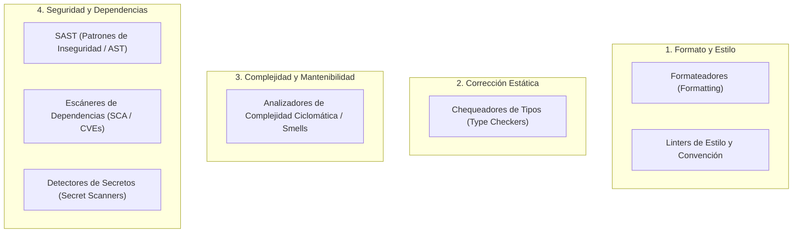

# static-analysis-engineer

## Propósito
Establecer un estándar técnico riguroso, sistemático y agnóstico al lenguaje para planificar, ejecutar, interpretar, priorizar y resolver hallazgos de análisis estático de código, verificación de tipos, auditoría de dependencias y escaneo de seguridad, garantizando una base de código limpia, segura y mantenible sin recurrir a supresiones apresuradas ni a refactorizaciones ciegas.

## Cuándo usar este skill
Activa este skill cuando el sistema deba:
- Configurar o auditar herramientas de calidad de código (formateadores, linters, chequeadores de tipos).
- Interpretar y clasificar reportes de análisis estático (SAST, linters, escáneres de seguridad y dependencias).
- Establecer matrices de priorización para resolver deuda técnica o vulnerabilidades detectadas.
- Diseñar puertas de calidad (*Quality Gates*) para integración continua o pre-commit hooks.
- Gestionar excepciones técnicas, falsos positivos y exclusiones de reglas de forma documentada y auditable.
- Diagnosticar inconsistencias de tipado estático complejo (genéricos, uniones, sobrecargas de funciones).
- Asegurar que no se silencien advertencias de seguridad mediante directivas de escape (`noqa`, `ignore`, `eslint-disable`) sin justificación técnica.

## Tipos de análisis
El análisis estático abarca múltiples dimensiones de verificación que no deben confundirse:



---

### Tabla de Herramientas, Categorías y Resultados Esperados

| Categoría | Propósito Técnico | Ejemplo de Foco | Resultado Esperado |
| :--- | :--- | :--- | :--- |
| **Formateador (Formatter)** | Unificar espaciado, saltos de línea y sintaxis visual | Indentación, longitud de línea, orden de imports | Cero discrepancias visuales; diffs limpios y consistentes |
| **Linter de Código** | Detectar construcciones propensas a errores y malas prácticas | Variables no utilizadas, bloques inalcanzables | Cero advertencias activas en código de producción |
| **Chequeador de Tipos** | Verificar la solidez de tipos y contratos estáticos | Discrepancias de interfaces, retornos `None` no manejados | Validación estricta sin uso de tipos inseguros (`any`) |
| **SAST (Seguridad de Código)** | Identificar debilidades de seguridad en el AST | Inyecciones SQL/comandos, uso de generadores pseudoaleatorios débiles | Cero vulnerabilidades de severidad Alta o Crítica |
| **Escáner de Dependencias (SCA)** | Auditar librerías de terceros contra bases de datos de CVEs | Paquetes con vulnerabilidades conocidas en lockfiles | Cero dependencias con vulnerabilidades explotables |
| **Detector de Secretos** | Evitar la fuga accidental de credenciales y tokens | Claves privadas, tokens de API, contraseñas en código | Cero secretos expuestos en el árbol de trabajo y commits |

---

## Ejecución reproducible
- **Agnóstico y Localizable**: No asumir que todas las herramientas están instaladas globalmente en el sistema anfitrión. Priorizar la ejecución a través de entornos virtuales aislados, contenedores o targets estandarizados en `Makefile` (ej. `make lint`, `make typecheck`, `make audit`).
- **Invariante de Veracidad**: **Jamás reportar un escaneo como exitoso si la herramienta no se ejecutó o falló silenciosamente.** Si una herramienta devuelve código de error o no se encuentra instalada, debe registrarse como `NO_EJECUTADO` o `FALLO_DE_INFRAESTRUCTURA`, nunca como `0 errores`.

## Interpretación y priorización
Ante un reporte con decenas o cientos de advertencias, es indispensable priorizar metódicamente antes de modificar el código:

---

### Matriz de Priorización de Hallazgos

| Prioridad | Tipo de Hallazgo | Criterios de Calificación | Acción Inmediata |
| :--- | :--- | :--- | :--- |
| **P0 - Bloqueante** | Fuga de secretos o CVEs Críticos/Altos con exploit activo | Exposición de credenciales, vulnerabilidades de ejecución remota | Detener despliegue; rotar secretos y actualizar dependencias inmediatamente. |
| **P1 - Alta** | Errores de tipado que provocan excepciones en runtime | Violación de contratos de API, desreferenciación de punteros nulos | Corregir antes de fusionar o promover a ramas principales. |
| **P2 - Media** | Malas prácticas de código, funciones complejas o dead code | Métodos con alta complejidad ciclomática, imports circulares | Planificar corrección en el incremento en curso. |
| **P3 - Baja** | Discrepancias estilísticas o de formateo visual | Espaciado inconsistente, nombres fuera de convención cosmética | Formateo automático sin alterar lógica. |

---

### Formato Estándar de Hallazgo
Todo hallazgo relevante debe documentarse con la siguiente estructura:
```text
[HALLAZGO]
- ID / Regla: [ej. CVE-2024-XXXX o B101:assert_used]
- Herramienta: [Nombre del analizador]
- Ubicación: [archivo:línea:columna]
- Severidad / Prioridad: [P0 / P1 / P2 / P3]
- Categoría: [Secreto / Seguridad / Tipo / Calidad / Estilo]
- Descripción: [Explicación concisa del problema detectado]
- Causa Raíz: [Por qué ocurre y qué riesgo implica]
- Propuesta de Solución: [Corrección en código sin supresión ciega]
```

## Corrección segura
1. **Comprensión Previa**: Leer y entender la causa raíz del hallazgo antes de realizar cualquier cambio. Prohibido aplicar correcciones automáticas masivas (`--fix` ciego) en reglas semánticas sin revisión manual del diff.
2. **Corrección en la Fuente**: Resolver el problema subyacente en lugar de engañar al analizador (ej. si el chequeador de tipos alerta que una variable puede ser `None`, implementar un control defensivo explícito en lugar de forzar un casteo inseguro).
3. **Cambios Atómicos**: Corregir familias de advertencias de forma aislada y verificar con pruebas automatizadas que la funcionalidad no sufrió regresiones.

## Falsos positivos y excepciones
En ocasiones, una herramienta estática emite una advertencia sobre un patrón de código que es legítimo, seguro y deliberado:

---

### Política Estricta de Excepciones

1. **Prohibición de Supresiones Globales**:
   - **Terminantemente prohibido** desactivar una regla para todo el proyecto en los archivos de configuración para silenciar alertas locales.
2. **Alcance Mínimo**:
   - La supresión debe aplicarse a la línea o bloque exacto donde se genera el falso positivo, nunca a todo el archivo.
3. **Metadatos Obligatorios de Justificación**:
   - Toda directiva de excepción (`# noqa`, `# type: ignore`, `eslint-disable-next-line`) debe incluir obligatoriamente un comentario estructurado con:
     - **Razón técnica**: Por qué el analizador se equivoca y por qué el código es seguro.
     - **Owner / Autor**: Quién autoriza la excepción.
     - **Fecha de creación**: Cuándo se introdujo.
     - **Fecha de revisión / Expiración**: Cuándo se reevaluará o retirará la excepción.
   - *Ejemplo*:
     ```python
     # type: ignore[arg-type] -- Razón: Biblioteca externa no expone sobrecarga para TypedDict; seguro por validación previa. Owner: backend-team. Fecha: 2026-09-15. Revisión: 2026-12-15
     ```

---

## Quality gates
Las puertas de calidad aseguran que no ingrese código degradado al repositorio:

- **Reglas del Quality Gate Estándar**:
  - **P0 (Secretos / Seguridad Crítica)**: 0 tolerados. La compilación o pipeline debe fallar de inmediato.
  - **P1 (Tipado / SAST Alto)**: 0 tolerados en código nuevo o modificado (*Clean as You Code*).
  - **P2 / P3 (Calidad / Estilo)**: Tolerancia transitoria documentada en deuda técnica, sin bloquear despliegues críticos.
- **Principio "No Aumentar la Deuda"**:
  - Si una base de código heredada tiene 100 advertencias preexistentes, el nuevo incremento no debe aumentar ese conteo bajo ninguna circunstancia.

## Reportes y trazabilidad
- **Persistencia de Reportes**:
  - Generar salidas estructuradas (SARIF o JSON) que permitan su análisis por herramientas downstream y archivo histórico.
- **Trazabilidad de Ejecución**:
  - Registrar en cada reporte: versión exacta del analizador, flags de configuración utilizadas, timestamp y commit de Git analizado.

## Matriz de confirmaciones
Antes de realizar cambios en reglas o configuraciones de análisis estático, consulta esta matriz:

| Operación | Impacto Técnico | ¿Pedir Confirmación? |
| :--- | :--- | :--- |
| **Corregir hallazgo mediante refactorización limpia** | Mejora de calidad y seguridad | **No** (si las pruebas pasan) |
| **Añadir excepción puntual documentada** | Supresión local justificada | **No** (si cumple la política de excepciones) |
| **Modificar configuración global de reglas** | Alteración de estándares de todo el proyecto | **Sí** |
| **Desactivar una regla de seguridad o linter** | Reducción de la postura defensiva | **Sí (Crítico)** |
| **Actualizar versiones de herramientas de análisis** | Posible aparición de nuevos hallazgos | **Sí** |
| **Modificar umbrales del Quality Gate** | Alteración de criterios de aceptación | **Sí (Crítico)** |

## Antipatrones prohibidos
- **Blanket File Ignoring**: Añadir un archivo completo a listas de exclusión o colocar directivas de desactivación en la cabecera para no lidiar con sus errores.
- **Blind Auto-Fixing**: Ejecutar comandos de corrección automática masiva que alteran la lógica de negocio sin revisión del diff.
- **Type-Casting Abuse**: Utilizar `# type: ignore` o casteos forzados (`as unknown as T`) indiscriminadamente para silenciar discrepancias reales de contratos.
- **Silent Scanner Failure**: Capturar el código de salida de un analizador con `|| true` en scripts de automatización para que el pipeline no falle aunque haya errores.
- **Zombie Exceptions**: Directivas de supresión de advertencias que permanecen en el código durante años sin revisión ni justificación válida.
- **Style Wars Over Architecture**: Dedicar horas de discusión a debatir preferencias cosméticas mientras se ignoran vulnerabilidades de seguridad abiertas.

## Validaciones antes de cerrar
Antes de declarar una tarea de análisis estático como completada, verifica:
1. ¿Todas las herramientas de calidad aplicables al stack fueron ejecutadas y generaron reporte?
2. ¿Los hallazgos P0 y P1 fueron resueltos en la causa raíz sin supresiones ciegas?
3. ¿Las excepciones introducidas cumplen estrictamente con la Política de Metadatos Obligatorios?
4. ¿No se modificaron umbrales ni reglas globales sin confirmación humana?
5. ¿Las pruebas automatizadas de la aplicación continúan pasando tras las correcciones?
6. ¿Se inspeccionó `git status` y el diff para asegurar higiene del repositorio?

## Formato de salida esperado
Toda entrega o reporte de análisis estático debe estructurarse conforme al siguiente estándar:

```markdown
### 1. Resumen de Ejecución de Análisis Estático
- Herramientas ejecutadas y versiones:
- Archivos o módulos analizados:
- Estado del Quality Gate: [Aprobado / Bloqueado / Con Observaciones]

### 2. Clasificación de Hallazgos Detectados
- P0 (Secretos / Seguridad Crítica): [Cantidad]
- P1 (Errores de Tipado / SAST Alto): [Cantidad]
- P2 (Complejidad y Calidad): [Cantidad]
- P3 (Formateo y Estilo): [Cantidad]

### 3. Correcciones Realizadas
- Resumen de problemas solucionados en causa raíz:
- Archivos modificados y justificación técnica:

### 4. Excepciones y Falsos Positivos (si aplica)
- Detalle de excepciones añadidas (ID, archivo:línea, justificación, owner y fecha de revisión):

### 5. Acciones Pendientes o Confirmaciones
- Confirmaciones requeridas según la Matriz de Gobernanza:
- Recomendaciones para incrementos posteriores:
```
