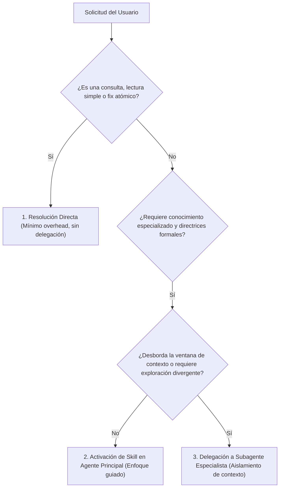
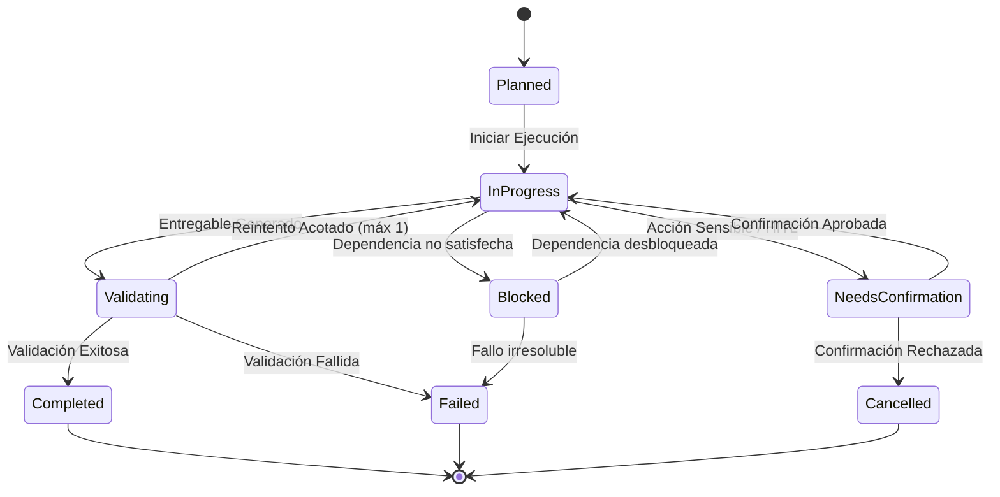

# task-orchestrator

## Propósito
Establecer un estándar de gobernanza, planificación, delegación y consolidación de tareas para un agente principal u orquestador de ingeniería de software, asegurando que los requerimientos se resuelvan con la mínima complejidad necesaria, bajo estricto control de autonomía, aislamiento de contexto en subagentes, trazabilidad formal y barreras obligatorias de confirmación humana.

## Cuándo usar este skill
Activa este skill cuando el agente principal deba:
- Clasificar una solicitud entrante del usuario antes de ejecutar acciones en el sistema.
- Decidir metódicamente si un requerimiento debe resolverse de forma directa, mediante activación de skills o delegando a un subagente aislado.
- Descomponer una tarea compleja en sub-tareas atómicas con dependencias y entregables verificables.
- Redactar instrucciones de delegación acotadas (*contexto mínimo*) para especialistas o subagentes.
- Coordinar múltiples flujos de trabajo mediante un patrón centralizado Hub-and-Spoke.
- Gestionar máquinas de estados finitos (FSM) para el ciclo de vida de tareas y bloqueos.
- Consolidar resultados heterogéneos en un reporte final transparente que no oculte discrepancias ni incertidumbres.

## Clasificación de solicitudes
Toda instrucción recibida del usuario debe categorizarse formalmente en una de las 9 tipologías operacionales:

1. **Explicación / Consulta Conceptual**: Resolución directa sin modificar el sistema ni ejecutar herramientas pesadas.
2. **Investigación Técnica**: Búsqueda documental, evaluación de alternativas y síntesis basada en evidencia.
3. **Análisis Estático / Auditoría**: Inspección de código, tipado, linting o detección de vulnerabilidades sin refactorización inmediata.
4. **Cambio Localizado**: Corrección de bug o ajuste menor acotado a un único archivo/módulo con pruebas existentes.
5. **Refactorización**: Reestructuración de código preservando contratos públicos y comportamiento externo.
6. **Diseño / Cambio de Arquitectura**: Modificación de límites entre capas, patrones, tecnologías o contratos de API.
7. **Seguridad / Control de Privilegios**: Análisis de amenazas, rotación de secretos o blindaje de endpoints.
8. **Evaluación de Modelos / IA**: Medición sistemática de rendimiento, datasets, trazas y suites de regresión.
9. **Despliegue / Infraestructura**: Contenerización, configuración de Compose, volúmenes o recursos.

## Principio de mínima complejidad
El orquestador debe aplicar la regla de economía operacional: **Nunca introduzcas mayor complejidad agéntica de la estrictamente requerida para completar la tarea de forma segura.**

---

### Árbol de Decisión: Directo vs Skill vs Subagente



- **Resolución Directa**: Cuando la tarea es una corrección puntual con pruebas, lectura de archivos o respuesta informativa. Prohibido crear subagentes para tareas triviales.
- **Activación de Skill**: Cuando la tarea exige rigor metodológico (ej. revisión de código, diseño de pruebas, análisis estático) pero puede ser ejecutada por el agente principal sin saturar el contexto.
- **Delegación a Subagente**: Exclusivamente cuando la tarea implique exploración masiva de código, búsquedas divergentes o procesamiento pesado que contaminaría el hilo de conversación principal.

## Descomposición y dependencias
- **Descomposición por Entregables Verificables**:
  - Dividir problemas complejos en pasos atómicos donde cada paso produzca un artefacto tangible (un archivo creado, un diff revisado, un test pasando, un reporte de métricas).
- **Mapeo de Dependencias**:
  - Identificar relaciones estrictas: la Tarea B no puede iniciar hasta que la Tarea A emita su resultado verificado.
- **Identificación de Riesgos y Puntos de Retorno (Rollback)**:
  - Para cada paso crítico, definir de antemano el mecanismo de reversión en caso de falla o rechazo.

## Selección de skills
- **Selección por Capacidad Operativa**:
  - Asociar cada sub-tarea a la skill cuyas directrices, checklists y contratos resuelven exactamente la necesidad técnica.
  - Prohibido activar skills de forma acumulativa o superficial basándose únicamente en nombres llamativos.
- **Cero Solapamiento**:
  - Si una tarea es de seguridad en endpoints, activar `application-security-engineer` o `backend-fastapi-engineer` según el foco; no saturar al agente con directrices redundantes.

## Delegación con contexto mínimo
Al delegar una tarea a un subagente, el orquestador debe aplicar la **Técnica del Contexto Mínimo Necesario**:

1. **Información Esencial**: Proveer únicamente el objetivo de la sub-tarea, las restricciones específicas, los archivos autorizados a leer/modificar y el schema del resultado esperado.
2. **Prohibición de Traspaso de Historial Completo**: Jamás volcar el log íntegro de la conversación principal al subagente.
3. **Coordinación Hub-and-Spoke Estricta**:
   - Los subagentes solo se comunican verticalmente con el orquestador (Hub).
   - **Terminantemente prohibida** la comunicación horizontal o en malla (*mesh*) entre subagentes.
   - Ningún subagente tiene autoridad para modificar decisiones arquitectónicas globales ni salirse de los archivos asignados.

---

### Plantilla de Tarea Delegada
```markdown
# TAREA DELEGADA: [TASK-ID]

- **Parent Task:** [PARENT-TASK-ID]
- **Asignado a:** [Nombre del Subagente o Rol Especialista]
- **Objetivo Específico:** [Descripción concisa en 1-2 oraciones del resultado esperado]
- **Archivos Autorizados:**
  - Lectura: [`ruta/archivo1.ext`, `ruta/archivo2.ext`]
  - Escritura: [`ruta/archivo_destino.ext`] (o Ninguno si es solo análisis)
- **Restricciones Inmutables:**
  - No modificar dependencias ni contratos públicos.
  - Timeout máximo: [X segundos / N pasos de herramientas].
- **Formato de Salida Esperado:** [JSON estructurado o plantilla de reporte específica]
- **Criterio de Finalización:** [Condición binaria verificable para dar por cerrada la tarea]
```

---

## Protocolo de tareas
Toda sub-tarea gestionada por el orquestador debe contar con un registro de estado formal y un identificador único:

```text
[Task Record]
├── task_id: Identificador único (ej. TSK-2026-004)
├── parent_task_id: Tarea superior o raíz
├── objective: Propósito funcional
├── state: Estado actual de la FSM
├── inputs: Parámetros y archivos provistos
├── outputs: Artefacto o resumen generado
├── evidence: Diff, logs o tests que acreditan el resultado
├── errors: Registro tipado de fallos (si aplicó)
├── deadline: Límite de tiempo o pasos
└── assignee: Rol responsable
```

## Estados y terminación
El ciclo de vida de cada tarea se rige por una Máquina de Estados Finitos (FSM) estricta:



- **Estados Terminales**: `Completed`, `Failed`, `Cancelled`. Una vez alcanzado un estado terminal, la tarea no puede reabrirse; debe crearse una nueva tarea si se requiere otra iteración.
- **Estado `NeedsConfirmation`**: Se activa inmediatamente antes de ejecutar cualquier acción irreversible o sensible. La tarea queda suspendida hasta recibir la respuesta explícita del operador humano.

## Confirmaciones y límites

---

### Matriz de Confirmaciones de Orquestación

| Naturaleza de la Acción | Nivel de Riesgo | ¿Pedir Confirmación Humana? |
| :--- | :--- | :--- |
| **Consultas, lecturas e inspecciones de código** | Seguro | **No** (proceder de forma autónoma) |
| **Corrección localizada con pruebas existentes** | Bajo | **No** (si los tests pasan limpiamente) |
| **Creación de nueva skill o documentación interna**| Bajo / Aditivo | **No** (si no altera código de negocio) |
| **Modificación de contratos públicos o APIs** | Alto / Ruptura | **Sí (Obligatorio)** |
| **Cambios de arquitectura, patrones o modelos** | Alto / Estructural | **Sí (Obligatorio con propuesta)** |
| **Adición o eliminación de dependencias** | Medio / Seguridad | **Sí** |
| **Eliminación o purga de archivos y datos** | Crítico / Destructivo | **Sí (Obligatorio con respaldo)** |
| **Ejecución de commits en Git** | Hito de Versionado | **Sí (Obligatorio tras revisar diff)** |

---

## Integración y validación
Antes de dar por concluida la orquestación general, el agente principal debe validar los resultados consolidados:

1. **Diferenciación de Estado Fáctico**:
   - Distinguir nítidamente entre lo **realmente ejecutado** (archivos escritos, tests pasados en verde) y lo **propuesto o planificado** para fases posteriores.
2. **Inspección de No-Regresión**:
   - Verificar `git status` y `git diff` asegurando que no se modificaron archivos fuera del alcance convenido.
3. **Consolidación Imparcial**:
   - Integrar los hallazgos de los subagentes o skills sin maquillar fallos, advertencias de seguridad ni limitaciones encontradas.

## Resumen final verificable
La respuesta entregada al usuario debe ser concisa, auditable y basada en hechos:

---

### Formato Estándar de Resumen Final de Orquestación

```markdown
# Resumen de Ejecución: [Nombre de la Tarea / Requerimiento]

- **Objetivo Principal:** [Meta cumplida]
- **Estrategia Aplicada:** [Resolución Directa / Skills Activadas / Subagentes Coordinados]
- **Estado General:** [COMPLETADO / COMPLETADO CON OBSERVACIONES / BLOQUEADO]

## 1. Desglose de Acciones Ejecutadas
- [x] **[Sub-tarea 1]**: [Descripción del cambio o análisis realizado]
- [x] **[Sub-tarea 2]**: [Descripción del artefacto generado]

## 2. Artefactos y Archivos Afectados
- **Archivos creados:** [`ruta/archivo.ext`]
- **Archivos modificados:** [`ruta/archivo.ext`]
- **Archivos preservados / no modificados:** [Lista explícita de componentes protegidos]

## 3. Verificación y Evidencia Técnica
- **Pruebas / Validaciones ejecutadas:** [Resultado de suites o comandos]
- **Estado de Control de Versiones:** [Salida de git status]

## 4. Conflictos, Fallos o Incertidumbres Detectadas
- [Registro honesto de cualquier limitación, discrepancia o advertencia]

## 5. Decisiones Pendientes y Siguientes Pasos
- [Preguntas o acciones que requieren autorización humana antes de continuar]
```

---

## Antipatrones prohibidos
- **Premature Delegation (Delegación Innecesaria)**: Desplegar subagentes para responder preguntas directas o realizar cambios de tres líneas de código.
- **Unbounded Autonomy Drift**: Permitir que un subagente decida por sí mismo ampliar el alcance de la tarea y modificar archivos ajenos a su asignación.
- **Mesh Communication Chaos**: Dejar que los subagentes se comuniquen entre sí sin pasar por el orquestador, perdiendo el control del estado y provocando bucles infinitos.
- **Context Flooding**: Enviar miles de líneas de contexto irrelevante a un especialista, degradando su precisión y disparando el consumo de tokens.
- **Silent Failure Concealment**: Informar al usuario que una tarea compleja fue completada con éxito cuando una de las sub-tareas falló o no se ejecutó.
- **Unapproved Destructive Actions**: Ejecutar borrados masivos, modificaciones de contratos o commits en Git sin solicitar confirmación humana previa.

## Validaciones antes de cerrar
Antes de declarar la orquestación como concluida y emitir el resumen al usuario, verifica:
1. ¿La solicitud fue clasificada adecuadamente y se aplicó el principio de mínima complejidad?
2. ¿Cada sub-tarea alcanzó un estado terminal válido (`Completed`, `Failed`, `Cancelled`)?
3. ¿Las acciones sensibles o destructivas contaron con confirmación humana previa?
4. ¿Se verificó que los archivos modificados coincidan exactamente con lo planificado?
5. ¿El resumen final refleja honestamente lo ejecutado vs lo propuesto, incluyendo limitaciones?
6. ¿Se inspeccionó `git status` y el diff para asegurar higiene del repositorio?

## Formato de salida esperado
Toda entrega de orquestación debe presentarse estructurada conforme al estándar:

```markdown
### 1. Clasificación y Plan de Orquestación
- Tipo de solicitud identificada:
- Estrategia seleccionada: [Directo / Skills / Hub-and-Spoke]
- Tareas coordinadas y dependencias:

### 2. Resultados por Sub-tarea
- [Detalle de estados y entregables por cada tarea del plan]

### 3. Evidencia y Control de Cambios
- Archivos creados o intervenidos:
- Verificación técnica y estado de Git:

### 4. Limitaciones o Decisiones Pendientes
- Advertencias, bloqueos o confirmaciones requeridas:
- Siguientes pasos propuestos:
```
