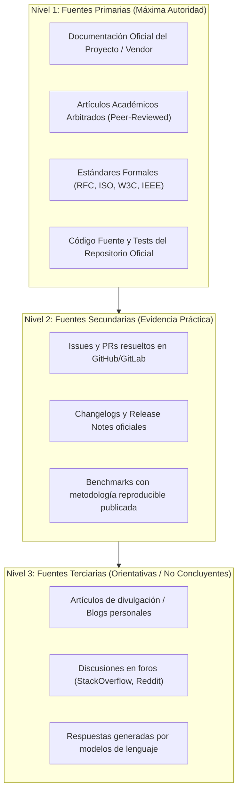

# technical-researcher

## Propósito
Establecer un estándar metodológico riguroso, científico y agnóstico para conducir investigaciones técnicas, auditar documentación oficial, evaluar literatura académica, contrastar alternativas arquitectónicas y formular recomendaciones ingenieriles fundamentadas en evidencia verificable, trazable y libre de afirmaciones especulativas o desactualizadas.

## Cuándo usar este skill
Activa este skill cuando el sistema deba:
- Investigar la viabilidad de una nueva tecnología, biblioteca, framework o protocolo antes de su adopción.
- Resolver discrepancias técnicas o lagunas de conocimiento entre múltiples fuentes de información.
- Comparar alternativas arquitectónicas mediante matrices de decisión multicriterio y análisis de trade-offs.
- Evaluar compatibilidad de software con restricciones específicas de hardware, arquitectura de CPU o sistema operativo.
- Diseñar pruebas de concepto (POC) o experimentos reproducibles para verificar comportamientos no documentados.
- Sintetizar documentación técnica compleja o artículos académicos en resúmenes operacionales accionables.
- Auditar la procedencia, vigencia y fiabilidad de fuentes técnicas en propuestas de ingeniería.

## Formulación de la pregunta
Antes de iniciar cualquier búsqueda documental o exploración de código, es obligatorio delimitar formalmente el alcance de la investigación:

1. **Pregunta Específica y Falsable**: Evitar consultas abiertas y genéricas; formular preguntas que puedan responderse con evidencia contrastable.
2. **Criterios de Éxito y Restricciones**: Definir las condiciones de contorno (lenguaje, licencias admisibles, huella de memoria máxima, soporte de plataforma, requisitos de latencia).

### Plantilla de Pregunta de Investigación
```markdown
# Formulación de Investigación: [ID-INV-001]

- **Pregunta Central:** [¿Cuál es el mecanismo más eficiente para X cumpliendo las restricciones Y y Z?]
- **Objetivo de la Decisión:** [Decidir entre la Alternativa A y la Alternativa B para el módulo C]
- **Restricciones No Negociables:**
  - Plataforma de ejecución: [ej. macOS ARM64 / Linux x86_64]
  - Modo de operación: [ej. Offline-first / Conexión a internet / Contenedor Docker]
  - Licencia de software: [ej. MIT / Apache 2.0 / Permisiva]
- **Criterios de Evaluación:** [Latencia, facilidad de integración, madurez, consumo de RAM]
```

## Estrategia de fuentes
La investigación debe regirse por una estricta **Jerarquía de Fiabilidad Documental**:



---

### Matriz de Fuentes y Grado de Confianza

| Tipo de Fuente | Nivel de Confianza | Uso Apropiado | Criterio de Validación |
| :--- | :--- | :--- | :--- |
| **Documentación Oficial** | Alto (Autoritativo) | Reglas de sintaxis, APIs, contratos y guías recomendadas | Contrastar contra la versión exacta instalada |
| **Código Fuente Oficial** | Absoluto (Factual) | Confirmar comportamiento real cuando la documentación es ambigua | Inspeccionar tests unitarios del repositorio |
| **Papers Académicos** | Alto (Metodológico) | Algoritmos, modelos formales y marcos teóricos | Verificar citas, fecha y contexto de experimentación |
| **Issues / PRs Cerrados** | Medio (Empírico) | Identificar bugs conocidos, workarounds y decisiones de diseño | Verificar si fue resuelto en releases posteriores |
| **Blogs / Tutoriales** | Bajo (Orientativo) | Descubrimiento de opciones y ejemplos de uso inicial | **Obligatorio** validar contra fuente primaria |

---

### Checklist de Calidad de Fuentes
- [ ] ¿La fuente corresponde a la versión exacta del software evaluado?
- [ ] ¿Es una fuente primaria (autor oficial o mantenedor directo)?
- [ ] ¿La información tiene menos de 18 meses de antigüedad o fue revalidada recientemente?
- [ ] ¿Los benchmarks citados detallan el hardware, parámetros y condiciones de prueba?
- [ ] ¿La evidencia distingue hechos verificados de opiniones de la comunidad?

## Evidencia primaria y comunitaria
Es imperativo etiquetar y separar formalmente el origen del conocimiento:

- **Hecho Verificado (Primary Fact)**: Información confirmada directamente en la documentación oficial, el estándar o el código fuente del proyecto.
- **Evidencia Comunitaria (Community Practice)**: Patrones de uso observados en issues de GitHub, discusiones de mantenedores o bibliotecas complementarias populares. Debe etiquetarse explícitamente como tal y no asumirse como garantía del fabricante.
- **Inferencia Analítica (Analytical Deduction)**: Deducción lógica realizada por el investigador a partir de hechos comprobados; debe presentarse como hipótesis sujeta a validación experimental.

## Análisis comparativo
La evaluación entre tecnologías competidoras debe realizarse mediante una **Matriz Comparativa de Alternativas**, evaluando trade-offs con objetividad:

---

### Matriz Comparativa de Alternativas

| Criterio de Evaluación | Peso Relativo | Alternativa A | Alternativa B | Alternativa C |
| :--- | :--- | :--- | :--- | :--- |
| **Cumplimiento Funcional** | Crítico | Total / Soporte nativo | Parcial / Requiere wrapper | Total / API madura |
| **Huella de Recursos (RAM/CPU)**| Alto | Ligera (< 200 MB) | Moderada (~ 500 MB) | Pesada (> 1.5 GB) |
| **Dependencias Externas** | Alto | Cero dependencias extras | Requiere servicio C++ nativo | Requiere runtime adicional |
| **Madurez y Mantenimiento** | Medio | Activo (releases mensuales) | Comunitario / Pocos commits | Respaldado por fundación |
| **Facilidad de Prueba Local** | Medio | Ejecución en memoria | Requiere contenedor Docker | Requiere clúster distribuido |
| **Trade-off Principal** | — | Mayor simplicidad, menor flexibilidad | Alto rendimiento, mayor complejidad de build | Riqueza de features, alto consumo de recursos |

---

## Contradicciones y limitaciones
- **Detección de Contradicciones**: Si la documentación oficial indica un comportamiento pero el código fuente o un issue de release muestra lo contrario, reportar la discrepancia explícitamente sin ocultarla.
- **Información Desactualizada**: Verificar siempre las fechas de los documentos. Muchas APIs y frameworks deprecian interfaces rápidamente; un tutorial de hace 2 años puede contener antipatrones o funciones obsoletas.
- **Reconocimiento Honesto de Vacíos**: Si un aspecto no está documentado ni puede deducirse con certeza, registrarlo explícitamente como **Limitación Documental** en lugar de inventar una conjetura.

---

### Plantilla de Hallazgo, Evidencia y Limitación
```markdown
### Hallazgo: [Título del Hallazgo Técnico]
- **Afirmación:** [Declaración técnica precisa]
- **Tipo de Evidencia:** [Hecho Verificado / Práctica Comunitaria / Inferencia]
- **Fuente Primaria:** [Enlace a documentación o commit con versión exacta]
- **Contexto de Validez:** [Aplica exclusivamente a versión X.Y bajo SO Z]
- **Limitación Identificada:** [Aspectos no cubiertos o dependientes de hardware]
- **Riesgo / Advertencia:** [Efecto secundario o incompatibilidad latente]
```

---

## Experimentos reproducibles
Cuando la documentación oficial sea ambigua o existan contradicciones documentales, el investigador debe proponer una **Prueba de Concepto (POC) Mínima Reproducible**:

1. **Aislamiento**: Diseñar un script o comando autocontenido que no dependa del sistema en producción.
2. **Hipótesis y Métricas**: Definir qué comportamiento se espera observar y cómo se medirá (tiempo de ejecución, código de retorno, consumo de memoria).
3. **Reproducibilidad**: Documentar las instrucciones exactas para que cualquier otro ingeniero pueda replicar la prueba en su propio entorno local.

## Síntesis y recomendaciones
El resultado final de una investigación técnica no debe ser un volcado masivo de texto, sino una **Síntesis Accionable Condicionada**:

- **Estructura Condicional**: Formular recomendaciones basadas en contextos específicos:
  - *"Si la prioridad es minimizar la latencia y la memoria, la recomendación es la Opción A porque..."*
  - *"Si se requiere soporte para streaming y tipado complejo de eventos, la recomendación es la Opción B porque..."*
- **Análisis de Consecuencias**: Detallar los costos de implementación, la curva de aprendizaje y el esfuerzo de mantenimiento a mediano plazo de la opción sugerida.

## Procedencia y citas
- **Cero Alucinaciones de Fuentes**: **Terminantemente prohibido inventar enlaces, títulos de papers, autores, versiones de librerías o métricas de benchmarks.** Toda cita debe ser real y verificable.
- **Prevención de Plagio**: No copiar párrafos extensos de documentación o artículos protegidos por derechos de autor. Sintetizar los conceptos técnicos en lenguaje propio citando la fuente original con su URL o referencia bibliográfica formal.

## Matriz de confirmaciones
Antes de trasladar hallazgos de investigación a la arquitectura del proyecto, consulta esta matriz:

| Tipo de Acción Post-Investigación | Impacto en el Proyecto | ¿Pedir Confirmación? |
| :--- | :--- | :--- |
| **Documentar comparativa técnica informativa** | Exploratorio / Sin impacto en código | **No** (entregar el reporte) |
| **Proponer script de experimento o POC aislada** | Validación empírica segura | **No** (si no toca código de producción) |
| **Adoptar hallazgo como decisión de arquitectura**| Cambio estructural en el sistema | **Sí (Obligatorio - ADR)** |
| **Sustituir una biblioteca, framework o modelo** | Impacto en dependencias y contratos | **Sí (Obligatorio)** |
| **Generar documentación formal de especificación**| Compromiso de diseño para el equipo | **Sí** |

## Antipatrones prohibidos
- **Hallucinated Benchmarking**: Citar cifras de rendimiento (ej. "el modelo X es 40% más rápido que Y") sin adjuntar el enlace a la prueba reproducible y las especificaciones exactas del hardware donde se midió.
- **Vendor Blog Blind Trust**: Aceptar como verdad objetiva las afirmaciones de marketing de una empresa sobre su propio producto sin contrastar contra usuarios independientes o pruebas empíricas.
- **Outdated StackOverflow Copy-Paste**: Proponer fragmentos de código de foros antiguos que utilizan APIs obsoletas o que violan los estándares de seguridad actuales del proyecto.
- **Scope Creep Investigation**: Desviarse hacia temas periféricos interesantes pero irrelevantes para responder la pregunta central de decisión.
- **Conflating Opinions with Facts**: Presentar preferencias personales o hábitos de la comunidad como si fueran requerimientos técnicos o estándares formales.

## Validaciones antes de cerrar
Antes de declarar una investigación técnica como completada, verifica:
1. ¿Se formuló una pregunta de investigación clara y con criterios de decisión específicos?
2. ¿Se priorizaron fuentes primarias (documentación oficial, código, papers) sobre blogs o foros?
3. ¿Se verificó la vigencia y correspondencia de versiones del software investigado?
4. ¿Se separaron nítidamente los hechos comprobados de las inferencias analíticas?
5. ¿Se explicitó el contexto de hardware y limitaciones de cualquier afirmación de rendimiento?
6. ¿La síntesis ofrece recomendaciones accionables condicionadas a las necesidades del proyecto?
7. ¿Se inspeccionó `git status` y el diff para asegurar que no se alteraron archivos fuera de la investigación?

## Formato de salida esperado
Toda entrega de investigación técnica debe estructurarse conforme al siguiente estándar:

```markdown
### 1. Formulación de la Investigación
- Pregunta central abordada:
- Criterios de decisión y restricciones consideradas:

### 2. Fuentes Consultadas y Procedencia
- Fuentes primarias analizadas (nombre, versión, URL oficial):
- Fuentes secundarias / comunitarias consideradas:
- Nivel de confianza de la evidencia: [Alto / Medio / Con reservas]

### 3. Análisis Comparativo y Trade-offs
- Matriz comparativa de alternativas:
- Aspectos positivos, negativos y limitaciones por opción:

### 4. Hallazgos Clave y Resolución de Discrepancias
- Hechos técnicos comprobados:
- Contradicciones o lagunas detectadas y cómo se resolvieron:
- Propuesta de experimento o POC (si aplicó):

### 5. Recomendación Condicionada y Siguientes Pasos
- Recomendación técnica justificada:
- Confirmaciones requeridas antes de adopción formal:
```
