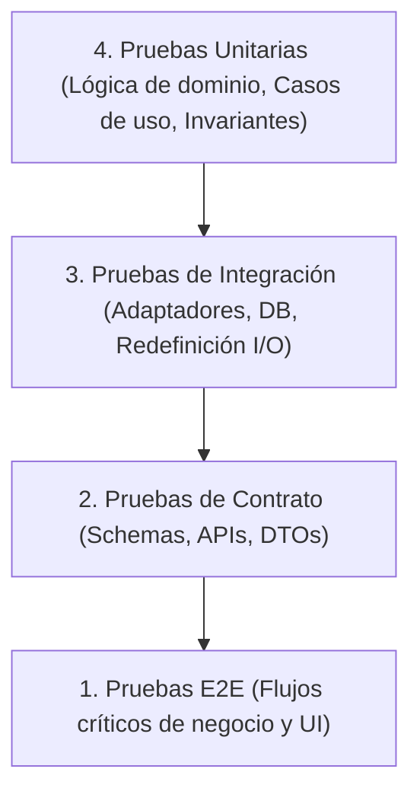

# test-automation-engineer

## Propósito
Establecer un estándar técnico riguroso y agnóstico para concebir, diseñar, automatizar y mantener suites de pruebas integrales en aplicaciones tradicionales y sistemas con componentes de Inteligencia Artificial, asegurando pruebas deterministas, aisladas, reproducibles y orientadas a la prevención de regresiones, distinguiendo claramente la verificación de software del benchmarking semántico de modelos.

## Cuándo usar este skill
Activa este skill cuando el sistema deba:
- Diseñar la estrategia de pruebas global o definir la pirámide de pruebas de un proyecto.
- Escribir o refactorizar pruebas unitarias rápidas y desacopladas de I/O externo.
- Diseñar pruebas de integración de adaptadores, repositorios o clientes de red.
- Validar contratos de API REST, esquemas JSON y serialización bidireccional.
- Implementar pruebas de extremo a extremo (E2E) para flujos críticos de usuario y accesibilidad.
- Diseñar fixtures, factories y generadores de datos mínimos independientes.
- Establecer políticas de uso de mocks, fakes y stubs, asegurando que nunca se usen mocks para falsear evaluaciones de IA.
- Probar escenarios de resiliencia: timeouts, fallas de red, reintentos, circuit breakers e idempotencia.
- Diagnosticar, aislar y erradicar pruebas intermitentes (*flaky tests*).

## Estrategia de pruebas
La arquitectura de pruebas debe organizarse según una **Pirámide de Pruebas Pragmática**, donde la velocidad, el aislamiento y el costo de mantenimiento determinan el nivel adecuado:



---

### Matriz Tipo de Prueba vs Propósito

| Tipo de Prueba | Nivel de Aislamiento | Velocidad de Ejecución | ¿Usa Red / DB Real? | Propósito Principal |
| :--- | :--- | :--- | :--- | :--- |
| **Unitaria** | Total (en memoria) | Ultrarrápida (< 10 ms) | No (Fakes/Mocks en puertos) | Validar lógica de negocio, reglas de dominio y transformaciones puras |
| **Integración** | Parcial (componente + infra) | Moderada (100–500 ms) | Sí (Contenedores/efímeros) | Validar comunicación real con adaptadores, bases de datos o brokers |
| **Contrato** | Frontera de comunicación | Rápida (< 50 ms) | No (Validadores de schema) | Garantizar compatibilidad sintáctica entre DTOs, APIs y clientes |
| **E2E** | Nulo (sistema completo) | Lenta (1 a 10 seg) | Sí (Entorno desplegado) | Verificar flujos de usuario críticos y accesibilidad de punta a punta |
| **Evaluación IA** | Semántica / Estadística | Variable (depende de LLM) | Sí (Runner de modelo real) | Medir calidad semántica, exactitud y alucinación sobre datasets |

---

## Pruebas unitarias
Las pruebas unitarias constituyen la base de la estabilidad del software:

1. **Patrón AAA (Arrange-Act-Assert)**:
   - Toda prueba debe estructurarse en tres fases nítidas y legibles: preparación de datos mínimos, invocación de la acción y verificación de efectos o valores retornados.
2. **Determinismo Absoluto**:
   - Una prueba unitaria debe arrojar el mismo resultado el 100% de las veces, sin importar el orden de ejecución, la zona horaria, la velocidad de CPU ni el sistema operativo.
   - **Prohibido**: Utilizar temporizadores ciegos (`sleep`), llamadas a red no controladas o números aleatorios sin semilla fija.
3. **Aislamiento e Independencia**:
   - Cada prueba debe ejecutarse de forma aislada sin depender del estado dejado por pruebas anteriores. No compartir variables globales mutables entre tests.

## Integración y contratos
- **Pruebas de Integración**:
  - Verificar que los adaptadores concretos (ej. cliente HTTP hacia servicios externos, repositorios de base de datos) implementan correctamente el contrato del puerto abstracto.
  - Usar servicios locales efímeros (ej. Testcontainers o mocks de red a nivel de socket como WireMock o MSW) en lugar de dependencias externas en la nube.
- **Pruebas de Contrato**:
  - Validar que las respuestas de los endpoints coinciden exactamente con las especificaciones de OpenAPI / JSON Schema.
  - Probar activamente la reacción ante payloads malformados, campos desconocidos (`extra="forbid"`) y tipos erróneos, verificando que el sistema emita respuestas 422 descriptivas y seguras.

## Pruebas E2E
- **Enfoque en Flujos de Valor**:
  - Reservar las pruebas E2E para los flujos más críticos y de alto impacto del usuario (ej. flujo de inicio a fin de un análisis, confirmación de una acción crítica).
- **Selectores Robustos y Accesibles**:
  - Seleccionar elementos en pantalla mediante roles de accesibilidad (`role`, `aria-label`, nombres de control visibles) en lugar de clases CSS o jerarquías frágiles del DOM.
- **Verificación Básica de Accesibilidad**:
  - Integrar herramientas automatizadas de escaneo de accesibilidad (ej. Axe-core) para detectar violaciones de contraste, etiquetas faltantes o problemas de foco durante las pruebas E2E.

## Fixtures y datos
1. **Datos Mínimos Necesarios**:
   - Cada prueba debe definir únicamente los campos relevantes para el caso que se está verificando. No utilizar fixtures gigantescas y complejas si la prueba solo evalúa un atributo booleano.
2. **Patrón Object Mother / Factory**:
   - Usar funciones fábrica (*factories*) con valores por defecto válidos y sobrescrituras específicas:
     `crear_usuario(saldo=100)` en lugar de duplicar diccionarios de 20 campos en cada archivo de prueba.
3. **No a los Datos Compartidos Frágiles**:
   - Evitar archivos de datos estáticos compartidos por cientos de tests que provoquen fallos en cascada cuando una prueba muta un registro compartido.

## Mocks y sistemas de IA
El uso de dobles de prueba (*mocks*, *stubs*, *fakes*) debe ser estrictamente disciplinado:

1. **Cuándo Usar Mocks / Fakes**:
   - Para aislar pruebas unitarias de software de la red y evitar incurrir en costos o latencias innecesarias.
   - Para simular fallos de infraestructura difíciles de reproducir (errores 500, caídas de conexión, timeouts o respuestas corruptas).
2. **REGLA DE ORO DE IA — Prohibición de Mocks en Evaluación**:
   - **Jamás utilizar mocks para reportar métricas de evaluación o calidad de un modelo de IA.**
   - Las pruebas de software pueden usar mocks para comprobar que el código parsea un JSON simulado; pero los reportes de exactitud, precisión, recall o alucinación **exigen ejecución con el modelo real (`evaluation_mode="real_model"`)**.
   - Publicar métricas de calidad de IA obtenidas contra mocks constituye una práctica deshonesta e inválida.

## Errores, resiliencia y concurrencia
Una suite de pruebas completa debe evaluar el comportamiento del sistema ante condiciones hostiles:

- **Pruebas de Límites de Tiempo (Timeouts)**:
  - Verificar que si un servicio descendente tarda más de lo tolerado, el cliente aborta la conexión inmediatamente y emite un error estructurado (ej. 504) sin congelar el hilo.
- **Pruebas de Idempotencia**:
  - Enviar la misma solicitud con la misma clave de idempotencia dos o más veces seguidas; verificar que la mutación se ejecuta una sola vez y las siguientes solicitudes retornan el resultado en caché.
- **Pruebas de Concurrencia**:
  - Ejecutar ráfagas de peticiones concurrentes para verificar que no se produzcan condiciones de carrera (*race conditions*) en el estado compartido ni bloqueos en pools de conexiones.
- **Degradación Segura (Fallback)**:
  - Simular la caída de un servicio secundario y comprobar que el sistema sigue operando en modo degradado ofreciendo una respuesta segura por defecto.

## Regresión y casos adversariales
1. **Pruebas de Regresión Obligatorias por Bug**:
   - Todo defecto o bug descubierto en producción o durante auditorías debe iniciar con la creación de una prueba que reproduzca el fallo antes de escribir la corrección (TDD de reparación).
2. **Batería de Casos Adversariales**:
   - Mantener un conjunto de pruebas dedicado a entradas maliciosas: inyecciones de prompt, cadenas extremadamente largas, caracteres Unicode especiales y números fuera de rango.

## Flakiness y reportes
Las pruebas intermitentes (*flaky tests*) destruyen la confianza en la suite automatizada:

- **Detección y Aislamiento**:
  - Una prueba que pasa o falla aleatoriamente sin cambios en el código debe aislarse de inmediato para su diagnóstico, identificando la condición de carrera o dependencia temporal subyacente.
  - **Prohibido**: Silenciar pruebas intermitentes mediante reintentos ciegos automáticos en bucle o ignorarlas permanentemente sin resolver la causa raíz.
- **Interpretación Prudente de la Cobertura**:
  - Un 100% de cobertura de líneas no implica ausencia de errores; solo indica que las líneas fueron ejecutadas, no que las aserciones validen todos los casos de borde o estados de error.
- **Artefactos de Fallo**:
  - Al fallar una prueba, el reporte debe persistir logs contextuales, trazas de excepción, inputs reproducibles y capturas de pantalla/trazas en pruebas E2E.

---

### Taxonomía de Fallos de Prueba

| Tipo de Fallo | Causa Raíz Frecuente | Síntoma Típico | Acción Correctiva |
| :--- | :--- | :--- | :--- |
| **Fallo Funcional** | Regresión en lógica de dominio | Aserción fallida en valor retornado | Corregir código de negocio o actualizar test si el cambio fue intencional |
| **Fallo de Contrato** | Desincronización de esquemas | Error 422 o excepción de serialización | Sincronizar DTOs entre cliente y servidor |
| **Fallo de Infraestructura** | Dependencia no iniciada o timeout | Conexión rechazada o timeout de socket | Verificar contenedor efímero o red de prueba |
| **Fallo Intermitente (Flaky)**| Dependencia de tiempo / Concurrencia | Falla ocasional en CI sin cambios | Eliminar `sleep`, usar esperas explícitas de eventos |
| **Fallo de Entorno** | Variables de entorno o paths ausentes | Error al cargar configuración | Asegurar `.env.test` aislado y reproducible |

---

### Checklist de Diseño de Test
Antes de dar por buena una prueba automatizada, verifica:
- [ ] ¿Sigue la estructura clara Arrange-Act-Assert?
- [ ] ¿Es completamente determinista y carece de temporizadores ciegos (`sleep`)?
- [ ] ¿Es independiente y puede ejecutarse aislada en cualquier orden?
- [ ] ¿Utiliza datos mínimos necesarios mediante factories en lugar de fixtures masivas?
- [ ] ¿Si usa mocks, verifica que la interacción sea estrictamente la esperada?
- [ ] ¿Comprueba los casos de borde y caminos de error, no solo el camino feliz (*happy path*)?

---

### Plantilla de Reporte de Pruebas

```markdown
# Reporte de Ejecución de Pruebas: RUN-20260915-01

- **Fecha:** 2026-09-15T16:50:00Z
- **Commit evaluado:** `388553e`
- **Ambiente:** Local Docker / macOS

## 1. Resumen de Ejecución
- **Total ejecutadas:** 48 pruebas
- **Exitosas:** 48
- **Fallidas:** 0
- **Omitidas (Skip):** 0
- **Duración total:** 2.45 segundos

## 2. Desglose por Nivel de la Pirámide
- **Unitarias:** 32 pruebas (100% éxito, duración: 0.35s)
- **Integración:** 10 pruebas (100% éxito, duración: 1.10s)
- **Contratos:** 6 pruebas (100% éxito, duración: 0.20s)
- **E2E:** 0 pruebas (ejecución separada en pipeline de UI)

## 3. Verificación de Resiliencia y Errores
- Timeouts defensivos verificados: Sí (2 pruebas de simulación de corte)
- Rechazos 422 por schema inválido: Sí (4 pruebas de payload corrupto)

## 4. Auditoría de Flakiness
- Pruebas intermitentes detectadas: 0
- Métricas de cobertura de código: 92% (en módulos de dominio y casos de uso)
```

---

## Matriz de confirmaciones
Antes de realizar alteraciones en la suite de pruebas, consulta esta matriz:

| Operación sobre Pruebas | Impacto Técnico | ¿Pedir Confirmación? |
| :--- | :--- | :--- |
| **Agregar nuevas pruebas unitarias/integración** | Incremento de cobertura y robustez | **No** (proceder autónomamente) |
| **Actualizar aserciones por cambio de regla** | Reflejo de nuevo comportamiento aprobado | **No** (si el cambio de lógica fue acordado) |
| **Eliminar pruebas existentes** | Reducción permanente de la red de seguridad | **Sí** (obligatorio justificar motivo) |
| **Marcar tests con `@skip` / `@ignore`** | Ocultamiento potencial de fallos reales | **Sí** (requiere justificación y plan de resolución) |
| **Modificar datasets baseline de evaluación** | Ruptura de comparabilidad histórica | **Sí (Crítico)** |
| **Reducir umbrales mínimos de cobertura** | Degradación de estándares de calidad | **Sí** |

## Antipatrones prohibidos
- **The Mockery (Abuso de Mocks)**: Mockear tantas capas que la prueba solo valida que los mocks se llaman entre sí, sin probar comportamiento real alguno.
- **Sleep-Driven Testing**: Usar `time.sleep(2)` para esperar respuestas asíncronas en lugar de usar esperas explícitas con reintentos (*polling* reactivo con timeout).
- **Silent Assertions**: Escribir pruebas sin aserciones claras que pasan siempre a menos que el código arroje una excepción fatal.
- **The Ice Cream Cone**: Invertir la pirámide de pruebas, teniendo pocas pruebas unitarias y cientos de pruebas E2E lentas, frágiles y costosas.
- **Reporting Eval Metrics on Mocks**: Generar reportes de exactitud de IA simulando las respuestas del LLM con cadenas estáticas.
- **Shared Mutable Fixture Chaos**: Mutar registros de prueba en una base de datos compartida provocando que los tests fallen de forma aleatoria según el orden de ejecución.

## Validaciones antes de cerrar
Antes de dar por concluida una tarea de automatización de pruebas, verifica:
1. ¿Todas las pruebas nuevas pasan consistentemente en ejecuciones repetidas?
2. ¿Se evitó el uso de temporizadores ciegos y llamadas a servicios externos en tests unitarios?
3. ¿Las pruebas de IA diferencian la verificación de software del benchmarking semántico real?
4. ¿No se eliminaron pruebas ni se marcaron tests como omitidos sin confirmación humana?
5. ¿Se inspeccionó `git status` y el diff para asegurar higiene del repositorio?

## Formato de salida esperado
Toda propuesta, suite o reporte de automatización de pruebas debe estructurarse conforme al siguiente estándar:

```markdown
### 1. Alcance de la Estrategia de Pruebas
- Módulos o flujos cubiertos:
- Nivel de la pirámide implementado: [Unitarias / Integración / Contrato / E2E]
- Enfoque de aislamiento y gestión de dependencias:

### 2. Casos de Prueba Diseñados
- Casos nominales verificados:
- Casos de error, límites y resiliencia (timeouts, 422, idempotencia):
- Casos adversariales o de no-regresión:

### 3. Gestión de Datos y Dobles de Prueba
- Estrategia de fixtures y factories:
- Política de mocks aplicada (sin simular evaluaciones reales de IA):

### 4. Resultados de Ejecución y Diagnóstico
- Métricas de ejecución (total, exitosas, fallidas, duración):
- Diagnóstico de fallos o ausencia de flakiness:

### 5. Acciones Pendientes o Confirmaciones
- Confirmaciones requeridas (eliminaciones, skips, umbrales):
- Recomendaciones para suites posteriores:
```
